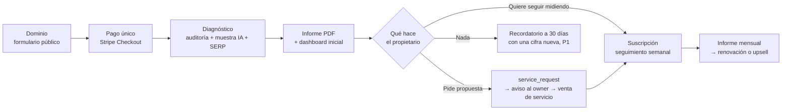

# 01 — Visión de producto

**Versión:** 1 (2026-10-25). **Estado:** PROPUESTO, pendiente de revisión cruzada (`13-codex-review.md`).
**Depende de:** `00-analysis-comparison.md` §7 (vocabulario) y `03-mvp-scope.md` (niveles P0/P1/P2/OUT).

## 1. Problema

Las pymes y los negocios locales dependen cada vez más de dos puertas de entrada que no controlan ni entienden: la búsqueda en Google y las respuestas de asistentes de IA (ChatGPT, Gemini, Perplexity, AI Overviews). El propietario típico no sabe:

| # | Carencia | Síntoma observable | Qué le da el producto |
|---|---|---|---|
| 1 | Cómo está posicionado en Google | «Busco mi negocio y no salgo» o «no sé qué busca la gente» | Posiciones SERP de keywords del sector y ciudad; con GSC (P1), consultas reales |
| 2 | Si aparece en ChatGPT, Gemini o Perplexity | Nunca lo ha comprobado; no sabe qué preguntar | Presencia observada en 2 superficies IA (P0) con preguntas comerciales reales |
| 3 | Qué competidores tienen más visibilidad | Intuición; «el de la calle de al lado sale siempre» | Cuota de voz entre marcas seguidas, dominios más citados |
| 4 | Qué problemas presenta su web | Web hecha hace años por un tercero; nadie la ha revisado | Auditoría técnica acotada con problemas por severidad y evidencia |
| 5 | Qué debería mejorar primero | Listas de 200 errores de herramientas gratuitas, sin orden | Acciones priorizadas por impacto y esfuerzo, en lenguaje de propietario |
| 6 | Si las actuaciones SEO/GEO producen avances medibles | Paga a una agencia y «no sabe si funciona» | Series semanales con línea base, nº de muestras y marcas de ruptura |

Las herramientas existentes (Semrush, Ahrefs, Otterly, Peec, SE Ranking) están pensadas para especialistas, se cobran por asiento o por prompt, y su licencia impide redistribuir los datos a clientes finales (UNVERIFIED en detalle; afirmado por Claude y Codex el 2026-10-25 con lectura de términos). Ninguna junta auditoría técnica, visibilidad IA y camino a un servicio profesional en un informe que un propietario entienda.

## 2. Cliente objetivo

### ICP primario (P0): pyme o negocio local en España

| Atributo | Valor |
|---|---|
| Tamaño | 1–50 empleados |
| Web | Propia, con dominio propio, normalmente WordPress, Wix o a medida por un tercero |
| Equipo SEO | Ninguno; a veces una agencia generalista o un diseñador freelance |
| Sector típico | Servicios locales (clínicas, despachos, talleres, reformas, restauración, formación), comercio con tienda física, pequeñas empresas B2B regionales |
| Presupuesto de marketing digital | 100–1.000 €/mes, decidido por el propietario |
| Disparador de compra | Caída de llamadas o visitas; un competidor que «sale en todas partes»; curiosidad por «si ChatGPT me recomienda» |
| Quién decide | El propietario o gerente, en una conversación de menos de 30 minutos |

### ICP secundario (P1): agencia pequeña de marketing o diseño web

| Atributo | Valor |
|---|---|
| Tamaño | 1–10 personas, 5–30 clientes activos |
| Necesidad | Justificar el trabajo mensual ante clientes con un informe que no sea una exportación de Semrush; detectar oportunidad de venta de servicios |
| Compra | Un workspace por cliente, marca propia en el informe (P2) |
| Riesgo | Soporte de primer nivel a sus clientes (el modelo de costes lo tiene en cuenta, ver `09-cost-model.md`) |

Los dos ICP comparten el mismo modelo de datos (`organizations` de tipo `company` o `agency` → `workspaces`); la UI de agencia es P1 y no condiciona el P0.

## 3. Propuesta de valor

**Para la pyme:** «En menos de una hora sabes cómo te ve Google y cómo te ve la IA frente a tus tres competidores, qué está mal en tu web y qué arreglar primero. Si contratas seguimiento, cada semana ves si avanza.»

**Para la agencia:** «Un informe mensual de SEO y visibilidad IA por cliente, con cifras trazables, que te ayuda a renovar y a vender la siguiente mejora.»

Diferenciadores frente a herramientas de especialistas:

1. **Lenguaje de propietario**: cuatro cifras, cada una con qué significa y qué hacer; sin jerga salvo en el anexo técnico.
2. **Trazabilidad**: cada número lleva fuente, nº de muestras, condición de captura y fecha. Nada se presenta como «lo que ve el usuario» si se obtuvo por API.
3. **Camino a la acción**: el informe termina en una propuesta de servicio o en un seguimiento, no en un dashboard que se consulta una vez.
4. **Precio de pyme**: pago único por auditoría y suscripción por marca, nunca por asiento ni por prompt.

## 4. Modelos de negocio y su nivel

| Modelo | Descripción | Nivel | Qué hace falta construir |
|---|---|---|---|
| **A. Auditoría puntual** | La pyme paga una vez, recibe PDF profesional y acceso al dashboard con la foto inicial | **P0** | Módulo A + D + Stripe Checkout pago único (`payments`, `entitlements` con `billing_source=stripe`) |
| **B. Suscripción de monitorización** | Dashboard de evolución, ejecución semanal GEO/SERP, competidores, recomendaciones, informe mensual | **P0 piloto** (activación manual de `entitlements`, cobro por transferencia o enlace de pago) / **P1 comercial** (Stripe Billing, `subscriptions`, Customer Portal) | Módulo B + C + E (P1) |
| **C. Servicios profesionales** | Rediseño web, optimización SEO/GEO, mantenimiento mensual, vendidos a partir del informe | **P0 captación** (`service_requests` + aviso al owner) / entrega del servicio fuera del producto | Módulo F mínimo. El servicio en sí no es software |
| **D. Comercialización B2B** | Agencias multi-cliente, marca blanca, API | **P1** (UI agencia) / **P2** (white-label, API pública, facturación de agencia) | El modelo de datos ya lo permite desde P0 sin coste extra |

## 5. Recorrido comercial

Cada paso tiene un dueño en el modelo de datos: `audits` → `reports`/`report_snapshots` → `service_requests` → `entitlements`/`subscriptions` → `monitoring_runs`. Ningún paso exige `lead-platform`; la integración con el CRM es P2.

## 6. Hipótesis de precio (variables, no decisiones)

Todos los precios son **UNVERIFIED** e **hipótesis**; el owner decide. Se expresan como variables para que `09-cost-model.md` las use.

| Variable | Hipótesis de trabajo | Anclas (UNVERIFIED, 2026-10-25) |
|---|---|---|
| `P_AUDIT` precio de la auditoría puntual | **149–249 €** pago único, IVA aparte | Ninguno de los dos informes lo modeló. Rango propuesto por comparación con lo que una agencia local cobra por un «análisis SEO» entregado en PDF y con el coste directo de ~1–3 $ por auditoría (ver `09`). Es una hipótesis a contrastar con tres ventas reales (desacuerdo D5 en `00`) |
| `P_SUB_BASE` suscripción mensual pyme | **79 €/mes** | Claude: 79 €/mes base (semanal); Codex: $79/mes. Coinciden de forma independiente |
| `P_SUB_PRO` suscripción con cadencia diaria / más superficies | **199 €/mes** (P1/P2) | Claude: 199 € Pro (diaria, 7 repeticiones). Codex no lo modela |
| `P_AGENCY` plan agencia | **49 €/workspace/mes, mínimo 5** o **299 €/mes hasta 5 workspaces** | Claude: 49 €/workspace, mínimo 5 (245 €); Codex: $299/mes hasta cinco empresas. Compatibles |
| `P_WHITE_LABEL` | A partir de 299–599 €/mes (P2) | Claude: 299 € + 39 €/workspace; Codex: desde $599. Fuera del MVP |
| Descuento auditoría → suscripción | El importe de la auditoría se descuenta del primer mes si se contrata en 30 días | Hipótesis propia para alinear A con B |
| Anclas de mercado citadas por ambos | Otterly 160–189 $/mes por 100 prompts; Semrush AI Visibility ~95–99 €/dominio/mes; SE Ranking 109–235 €; Nightwatch 79–399 € | UNVERIFIED; leídas por Claude y Codex el 2026-10-25 |

Regla de precios heredada de ambos informes: **los límites del plan son exactamente las variables de coste** (prompts, superficies, repeticiones, cadencia, keywords, páginas auditadas). «Prompts ilimitados» no se ofrece.

## 7. Lo que el producto NO es

- No es un CRM: `service_requests` registra solicitudes, no gestiona ventas. Eso es `lead-platform`.
- No es un generador de webs ni un redactor de contenidos.
- No es un agente autónomo que modifica la web del cliente.
- No es un rank tracker de especialista (ni top 100 diario, ni backlinks, ni autoridad de dominio).
- No es una herramienta de «volumen de prompts» ni de «ranking universal IA»: esas cifras no tienen base verificable.
- No promete atribución causal visibilidad → lead → venta. Puede mostrar correlaciones etiquetadas (P2, con conector a `lead-platform`).
- No es white-label en el MVP.
- No usa Semrush ni Ahrefs como fuente redistribuida, ni Gemini Grounding/Bing grounding como fuente histórica.

Lista completa en `03-mvp-scope.md` §5.

## 8. Métricas de éxito comerciales del piloto

Ventana: primeros 90 días con producto en producción. Objetivos como hipótesis a revisar tras las 10 primeras auditorías.

| Métrica | Definición | Objetivo del piloto | Cómo se mide |
|---|---|---|---|
| Auditorías pagadas | `payments` completados por auditoría | ≥ 10 en 90 días | Tabla `payments` |
| Conversión informe → solicitud de propuesta | `service_requests` / informes de auditoría entregados | ≥ 30 % | `service_requests` con `source=report` / `reports` entregados |
| Conversión informe → suscripción | `entitlements` de suscripción activados en ≤ 30 días desde el informe / auditorías entregadas | ≥ 20 % | `entitlements.activated_at - reports.delivered_at` |
| Renovación al mes 2 | Suscriptores que siguen activos al inicio del segundo ciclo / suscriptores activados | ≥ 70 % | `entitlements` activos vs cancelados |
| Decisión útil identificada | El cliente nombra al menos una acción tomada a raíz del informe (encuesta de 1 pregunta a 14 días) | ≥ 50 % de los que responden | Encuesta manual en el piloto |
| Tiempo de soporte por cliente | Horas del owner por cliente y mes | ≤ 0,5 h/mes | Registro manual; alimenta `09-cost-model.md` |
| Coste directo por auditoría | Suma de `usage_events` del `audit` | ≤ 1,5 × estimación de `09` | `usage_events` |
| Cobertura operativa semanal | Observaciones obtenidas / programadas | ≥ 95 % | `metric_rollups` |

Si tras 10 auditorías la conversión a solicitud o a suscripción queda por debajo de la mitad del objetivo, se revisa precio y contenido del informe **antes** de invertir en el P1 (Stripe Billing, agencia).

## 9. Relación con `lead-platform`

El producto funciona sin el CRM: alta, pago, medición e informe no dependen de él (acuerdo de ambos informes, `00` §5). La relación es comercial y por fases:

| Fase | Integración | Nivel |
|---|---|---|
| Piloto | Ninguna. El owner recibe `service_requests` por email/Telegram y las trata donde quiera | P0 |
| SaaS inicial | Enlace desde el CRM al dashboard; exportación de `service_requests` al webhook de formularios del CRM (VERIFIED que existe `api/webhooks/forms` en `lead-platform` `983dfb6`) | P2 |
| Posterior | Conector de leads por tenant para enseñar «visibilidad → leads» como correlación etiquetada; enlace firmado de un solo uso | P2 |

## Notas de coherencia

- El nivel de la suscripción (modelo B) se declara «P0 piloto con activación manual / P1 comercial» siguiendo `03` §3 Módulo E: Stripe Checkout de pago único es el único cobro automático del P0; la suscripción se activa a mano en la vista admin hasta P1.
- El recordatorio a 30 días del recorrido comercial no está en `03`; se marca P1 y se propone añadirlo al Módulo F en la siguiente versión de `03`.
