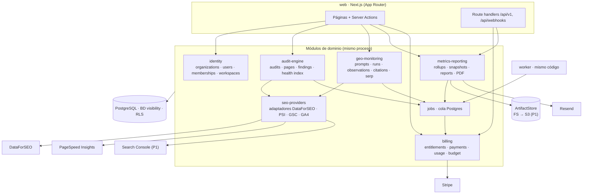
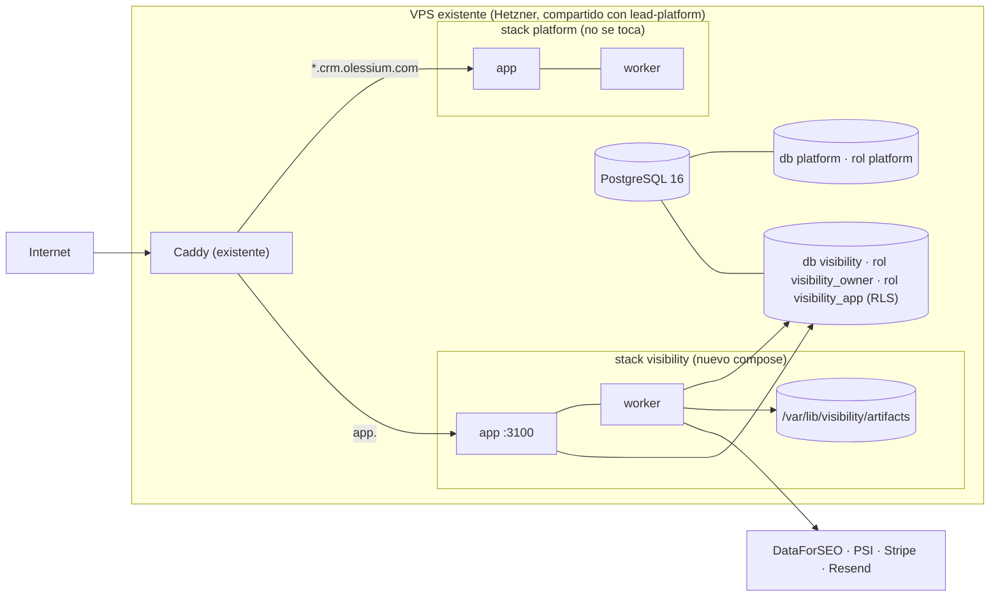
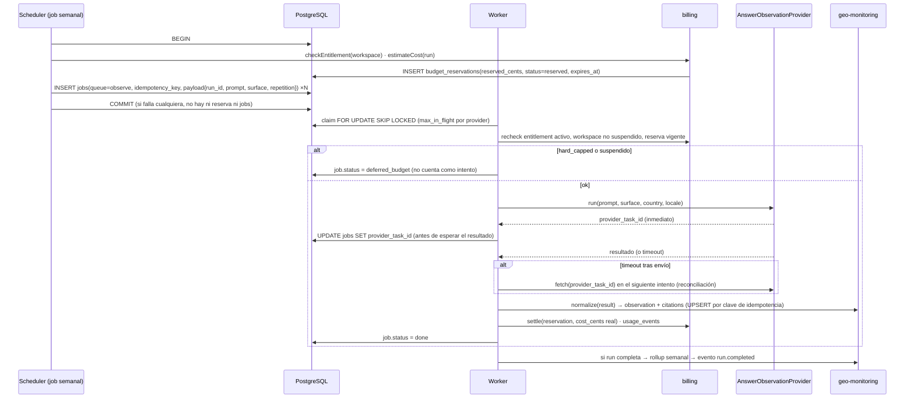

# 04 — Arquitectura técnica

**Versión:** 1 (2026-10-25). **Estado:** PROPUESTO, pendiente de revisión cruzada (`13-codex-review.md`).
Vocabulario: `00-analysis-comparison.md` §7. Alcance: `03-mvp-scope.md`.

## 1. Principios

1. **Monolito modular.** Una aplicación Next.js y un worker con el mismo código e imagen. Los módulos se separan por carpetas y por reglas de importación, no por procesos. Microservicios solo con una señal medida (coincide con D015/D020 del workspace, VERIFIED).
2. **Independencia de `lead-platform` en cuatro planos.** Código: ningún import hacia `lead-platform`; lo reutilizado se copia con procedencia. Despliegue: imagen, stack compose y release propios. Datos: base de datos, rol y backups propios; ninguna FK ni vista cruza. Comercial: alta, pago y uso sin tenant CRM. `lead-platform` es, como mucho, un conector (P2).
3. **Comprar datos, construir dominio.** Se compran SERPs, observación de interfaces IA y procesamiento de pagos. Se construyen onboarding, auditoría acotada, histórico, métricas explicables, informes y control económico. No se construyen scrapers, proxies ni índices.
4. **Nada sin señal medida.** Redis, Timescale, particionado, S3, N workers, host propio: cada uno tiene un umbral numérico en §12 que lo dispara.
5. **Toda cifra es trazable.** Cada observación conserva proveedor, id externo, condición de captura, coste y versión del normalizador. Cada número del informe sale de un `report_snapshot` inmutable.

## 2. Tecnologías y justificación

| Tecnología | Decisión | Por qué | Alternativa descartada y por qué |
|---|---|---|---|
| **Next.js (App Router) + TypeScript strict** | Sí, P0 | Un solo lenguaje para web, API y worker; stack ya operado por el equipo en `lead-platform` (VERIFIED: Next 16.3.6, TS 5.9); SSR para el informe web, que es la misma plantilla que el PDF | Remix/SvelteKit: sin ventaja que compense perder la experiencia acumulada. SPA + API aparte: dos despliegues y duplicación de validación |
| **PostgreSQL** | Sí, BD lógica propia en la instancia existente | Series, jsonb, RLS, cola de jobs y transacciones en un solo motor; volumetría de P0/P1 cabe sin particionar (ver `05-data-model.md` §6) | Timescale/ClickHouse: ambos informes coinciden en que no hay volumen que lo justifique. Instancia separada desde el día 1: coste y operación sin señal |
| **Drizzle** (ORM existente) | Sí | Los módulos que se copian (`jobs`, `with-tenant`, `secrets`) están escritos sobre Drizzle; migraciones SQL explícitas que permiten RLS y `SET LOCAL ROLE` sin pelear con el ORM; una sola herramienta de ORM en el workspace para una sola persona | Prisma: existe en `proycto-cumbre` y `olessium-ui` (VERIFIED según ambos informes) pero obligaría a reescribir la cola, RLS y crypto, y su cliente no expone `SET LOCAL ROLE` de forma natural dentro de una transacción |
| **Auth propia** (email + contraseña scrypt, sesión en BD, invitación por enlace) | Sí, reescrita sobre el patrón de LP | Decenas de usuarios, no miles; el patrón está probado (VERIFIED `src/lib/console/auth.ts`); hay que añadir membresías multi-organización, que el original no tiene | Clerk/Auth0/Supabase Auth: coste por usuario activo y dependencia externa para el login de un producto pequeño; SSO empresarial no lo pide nadie. Se reevalúa en P2 si una agencia exige SSO |
| **API propia** | Server Actions para el dashboard; route handlers `/api/v1/*` para webhooks, descargas firmadas, checkout y, en P2, API pública | Server Actions dan CSRF y tipado sin duplicar DTOs; los handlers HTTP quedan para lo que necesita una URL (Stripe, descargas, terceros) | tRPC/GraphQL: capa extra sin consumidor externo en P0 |
| **Jobs y colas en Postgres** | Sí, copia de `jobs.ts` de LP con `idempotency_key`, `queue`, `provider` | Reclamo atómico `FOR UPDATE SKIP LOCKED`, backoff y dead-letter ya probados (VERIFIED `jobs.ts:93,139`); la cola comparte transacción con la reserva de presupuesto, lo que Redis no permite | Redis/BullMQ: segundo almacén que operar, sin transacción con la BD; pg-boss: añade dependencia para lo que ya está copiado |
| **Object storage** | P0: sistema de ficheros del VPS (`/var/lib/visibility/artifacts`) incluido en el backup cifrado; P1: bucket S3-compatible (Hetzner Object Storage o equivalente) | En P0 hay decenas de PDFs al mes; un bucket añade credenciales, SDK y coste fijo sin volumen. El código habla con una interfaz `ArtifactStore` desde P0 para que el cambio sea un adaptador | S3 desde P0: coste y superficie innecesarios para el piloto |
| **Integración GSC / GA4** | GSC P1, GA4 P1, ambas por OAuth 2.0 del propietario con refresh token cifrado | Son las únicas fuentes que miden exposición real del cliente; gratuitas; exigen verificación de la app en Google (UNVERIFIED el plazo exacto; ambos informes lo sitúan en días hábiles) | Pedir al cliente exportaciones manuales: no escala ni permite series |
| **Proveedores GEO/SERP** | DataForSEO detrás de `SerpProvider` y `AnswerObservationProvider`; Perplexity API P1; Serper P1 como segundo SERP | Pago por uso, sin cuota fija; ambos informes coinciden de forma independiente (precios UNVERIFIED, leídos el 2026-10-25) | Semrush/Ahrefs: términos de uso interno, caché limitada (UNVERIFIED pero señalado por ambos); herramientas de AI visibility: cobran por marca, API solo en planes altos |
| **Rendimiento web** | PageSpeed Insights API detrás de `PerformanceProvider` | Gratuita, devuelve laboratorio y campo (CrUX) | Lighthouse propio en el VPS: Chromium por auditoría compite con el PDF por memoria |
| **Stripe** | Checkout pago único P0; Billing + Customer Portal P1 | Único procesador que ambos informes contemplan; Checkout evita manejar tarjetas | Paddle/Lemon Squeezy: resuelven IVA como merchant of record, pero `lead-platform` y Cumbre ya conocen Stripe y el volumen no justifica otro proveedor. Se anota como alternativa en `11-risks` si la fiscalidad lo exige |
| **PDF** | Chromium headless (Playwright) en el worker, desde la plantilla HTML del informe | Una sola plantilla, dos salidas; Playwright ya es dependencia de test en LP | PDFKit (Cumbre lo usa, VERIFIED según Codex): segunda plantilla a mantener. Servicio externo HTML→PDF: plan B si Chromium no cabe en el VPS |
| **Email** | Resend por `fetch`, copia de `EmailProvider` | Patrón existente (VERIFIED `src/lib/email/`) | SES: más configuración para decenas de correos al mes |
| **Observabilidad** | Sentry + logger estructurado (pino) + `audit_log` + `ops_metrics` | Aquí el coste por llamada importa; LP no tiene logger estructurado (VERIFIED) y se corrige en este repo | Prometheus/Grafana: sin señal |

## 3. Módulos y límites

### 3.1 Responsabilidades

| Módulo | Responsabilidad | Tablas que posee | Expone | Prohibido importar |
|---|---|---|---|---|
| **identity** | Alta, login, sesiones, organizaciones, membresías, grants, `withWorkspace()` | `organizations`, `users`, `memberships`, `workspace_grants`, `workspaces`, `sessions`, `invites`, `auth_rate_limits` | `currentContext()`, `authorize(role, resource)`, `withWorkspace(id, fn)` | Todo lo demás (es la base) |
| **audit-engine** | Descubrimiento acotado, fetch seguro, reglas, índice de salud, línea base GEO de la auditoría (delega la observación en geo-monitoring) | `audits`, `audit_pages`, `audit_findings`, `performance_samples`, `competitors` (compartida con geo), `keywords` | `requestAudit(workspaceId, config)`, evento `audit.completed` | `billing` (solo a través de `jobs`), `web` |
| **seo-providers** | Adaptadores y fakes de todas las interfaces de §4; registro de uso por llamada | ninguna propia (escribe `usage_events` vía billing) | Las seis interfaces de §4 y `providerRegistry` | Dominio (`audits`, `observations`): recibe y devuelve DTOs |
| **geo-monitoring** | Prompts y versiones, programación de runs, normalización de respuestas, menciones, citas, SERP | `prompts`, `monitoring_runs`, `observations`, `citations`, `serp_positions` | `scheduleRun()`, `approvePromptSet()`, evento `run.completed` | `metrics-reporting`, `web` |
| **metrics-reporting** | Rollups, snapshots, plantilla de informe, PDF, envío, enlaces firmados, recomendaciones por reglas | `metric_rollups`, `report_snapshots`, `reports`, `recommendation_rules` (config tipada, no tabla en P0) | `buildSnapshot()`, `renderReport()`, evento `report.generated` | `seo-providers` (lee solo tablas propias y de geo/audit) |
| **billing** | Entitlements, pagos, suscripciones (P1), uso, pricing, reservas, tope duro, webhooks Stripe | `entitlements`, `payments`, `subscriptions`, `usage_events`, `provider_pricing`, `budget_reservations` | `reserve()`, `settle()`, `release()`, `checkEntitlement()`, evento `budget.hard_capped` | Dominio de auditoría/geo |
| **jobs** | Cola, claim, backoff, dead-letter, idempotencia, colas lógicas, concurrencia por proveedor | `jobs` | `enqueue()`, `runWorker()` | Nada de dominio: los handlers se registran desde cada módulo |
| **web** | Páginas, Server Actions, handlers HTTP, componentes | ninguna | — | Tablas directamente: siempre vía funciones de módulo |
| **captación** (`service_requests`) | Vive en `identity` como submódulo `requests` en P0 | `service_requests` | `createServiceRequest()` | — |

La regla de importación se hace cumplir con una comprobación de lint por carpeta (`eslint-plugin-boundaries` o regla propia); es parte del P0 porque es lo único que mantiene el monolito modular.

### 3.2 Despliegue

Capacidad: la RAM libre del VPS es UNVERIFIED (ambos informes). Medirla es la primera tarea de infraestructura del backlog; si Chromium para PDF no cabe, se externaliza (ver §12).

## 4. Interfaces intercambiables de proveedores

Todas devuelven un `ProviderResult<T>` con metadatos obligatorios: `provider`, `provider_task_id` (nullable si el proveedor no lo da), `cost_cents`, `capture_condition`, `normalizer_version`, `requested_at`, `observed_at`, `raw` (conservado 90 días). Todas tienen un `Fake*` determinista para tests y un `Recording*` que graba respuestas reales anonimizadas para fixtures.

| Interfaz | Entrada | Salida normalizada | Adaptadores P0 | Adaptadores P1 | Notas |
|---|---|---|---|---|---|
| `AuditFetcher` | `url`, `maxBytes`, `timeoutMs`, `respectRobots` | `status_code`, `redirect_chain`, `headers`, `html` (o `fetch_error`) | `SafeHttpFetcher` (propio, con SSRF §6) | — | Único adaptador que construimos; no hay proveedor |
| `PerformanceProvider` | `url`, `strategy mobile|desktop` | `lcp, cls, inp, fcp, ttfb`, `lab_or_field`, `score` | `PageSpeedInsightsProvider` | — | Cuota y términos de PSI: UNVERIFIED; el adaptador trata `429` como `retryable` y la ausencia de campo (`field`) como `null`, no como error |
| `SearchPerformanceProvider` | `integrationId`, `from`, `to`, `dimensions` | filas `search_daily` con `completeness` | — | `GscProvider` | GSC devuelve filas principales, no todas las combinaciones (Codex, UNVERIFIED) |
| `SerpProvider` | `keyword`, `location`, `locale`, `device`, `depth 10|20|50|100`, `includeAio` | `positions[]`, `serp_features`, bloque AIO (`text`, `citations[]`) si existe | `DataForSeoSerpProvider` | `SerperProvider` (sin AIO) | AIO vía SERP de DataForSEO: capacidad afirmada por ambos informes, UNVERIFIED en esta sesión |
| `AnswerObservationProvider` | `prompt`, `surface`, `country`, `locale` | `text`, `citations[] {url, title?}` (puede ser vacío), `capture_condition` | `DataForSeoLlmScraperProvider` (`chatgpt`; `gemini` P1) | `PerplexityApiProvider` (`api_with_search`) | **UNVERIFIED** que el LLM Scraper devuelva URLs de cita estructuradas; el normalizador acepta `citations: []` y, si solo hay texto, extrae URLs del texto marcándolas `source: text_extracted` |
| `AnalyticsProvider` | `integrationId`, `from`, `to` | sesiones y conversiones orgánicas por día | — | `Ga4Provider` | P1 |

Cambiar de proveedor en una serie **no autoriza a unir las series**: `metric_rollups` lleva `methodology_version`, y un cambio de adaptador en una superficie incrementa esa versión y pinta una marca de ruptura (igual que un cambio de prompts).

## 5. Flujo de un job de observación con reserva de presupuesto

Reglas:

- **Reserva y encolado en la misma transacción.** Sin reserva no hay job; sin job no hay reserva huérfana. Las reservas caducan (`expires_at`) y un barrido las libera.
- **`provider_task_id` se guarda antes de esperar.** Si el worker muere después del envío, el job pasa al estado `reconcile` (no a reintento inmediato) y el siguiente intento busca el id y reconcilia en vez de volver a comprar.
- **Exactamente-una-compra no se garantiza** cuando el proveedor no ofrece idempotencia ni consulta por id. Se garantiza *como máximo una observación* (clave única) y *como máximo un intento de reconciliación antes de recomprar*. La diferencia se registra como `usage_events.operation = duplicate_purchase` para medirla.
- **Reintentos de transporte no son repeticiones.** La repetición es parte de la clave de idempotencia; un reintento del mismo job escribe sobre la misma fila.
- **Coste en fallos también cuenta.** Un `provider_error` con cargo del proveedor se liquida igual.
- El rollup se recalcula por `(workspace, period, metric_key, surface)` al cerrar cada run; es idempotente.

## 6. Seguridad

| Área | Diseño |
|---|---|
| **Aislamiento (RLS)** | `withWorkspace(workspaceId, fn)` copia de `withTenant` (VERIFIED `with-tenant.ts:60-75`): transacción, `set_config('app.workspace_id')`, `SET LOCAL ROLE visibility_app`, tipo marcado `WorkspaceTx`. Matiz heredado y documentado: **la conexión del rol dueño salta RLS**; ninguna consulta de dominio acepta `db` sin marca. Lint que prohíbe importar `db` fuera de `identity/db` y `jobs`. Suite `tests/isolation` copiada y ampliada a handlers HTTP |
| **Acceso de plataforma** | Rol `platform_admin` en `users`; sus consultas pasan por `withPlatformAccess(reason)` que no cambia de rol pero escribe `audit_log(actor, reason, scope)`. Solo en rutas `/admin`. Equivalente a D026 de LP |
| **SSRF en `AuditFetcher`** | Resolver DNS antes de conectar y conectar a la IP resuelta (evita rebinding); bloquear `10/8`, `172.16/12`, `192.168/16`, `127/8`, `169.254/16`, `0/8`, `::1`, `fc00::/7`, `fe80::/10` y direcciones mapeadas IPv4-in-IPv6; solo `http`/`https` en puertos 80/443 (y el puerto explícito del dominio raíz introducido); máximo 5 redirecciones revalidando cada salto; 5 MB por página; 15 s de timeout; `User-Agent: VisibilityPlatformBot/1.0 (+url de política)`; respetar `robots.txt` (`Disallow` para nuestro UA o `*`) para las páginas del crawl; límite de 1 petición concurrente por host y 30 páginas por auditoría en P0 |
| **Credenciales OAuth (P1)** | Cifradas inline en `integrations` con AES-256-GCM y `key_version` (copia de `secrets/crypto.ts`, VERIFIED); nunca al navegador ni a logs; `state` firmado y ligado a sesión + workspace + operación; PKCE; revocación en Google al borrar la integración; `reauth_required` en `invalid_grant` |
| **Enlaces firmados** | HMAC sobre `(report_id, expires_at)` con clave de servidor; caducidad 7 días; el handler revalida que el informe pertenece al workspace y que el snapshot existe; descargas registradas en `audit_log` |
| **CSRF** | Server Actions con comprobación de origen (patrón `authorizeWrite` de LP, VERIFIED); handlers HTTP públicos solo para webhooks firmados y descargas por token |
| **Formulario público de auditoría** | Rate limit por IP y por dominio en Postgres (patrón `auth_rate_limits`); validación de dominio (sintaxis, no IP literal, no `localhost`); el fetch solo arranca tras el pago confirmado |
| **Webhooks Stripe** | Verificación de firma con el secreto del endpoint; `stripe_events(event_id UNIQUE)` procesado en la misma transacción que el efecto; reentrega → no-op |
| **Secretos** | Solo en env del compose (`DATABASE_URL`, `MASTER_KEY_v1`, `STRIPE_*`, `DATAFORSEO_*`, `RESEND_*`); nunca por workspace en P0 salvo OAuth cifrado |
| **Scrubbing** | Sentry con `beforeSend` que elimina `Authorization`, cookies, tokens y `response_text` |
| **Borrado y exportación (P1)** | Borrado de workspace = `DELETE` en cascada + purga de artefactos + revocación OAuth + evento; exportación CSV/JSON por job |

## 7. Costes por organización

- `provider_pricing(provider, operation, unit_cost_cents, valid_from)` es configuración versionada; un `check:pricing` en el deploy falla si una operación usada no tiene precio vigente (patrón `pricing-coverage.ts` de LP, VERIFIED).
- `usage_events` registra cada llamada con coste; `budget_reservations` el coste comprometido.
- **Tope duro mensual por workspace** = `entitlements.limits.monthly_budget_cents` (derivado del plan). Estado = `ok` (< 80 %), `soft` (80–100 %, aviso al owner y al cliente), `hard_capped` (≥ 100 %).
- Al llegar a `hard_capped`: no se crean reservas nuevas; los jobs pendientes de ese workspace pasan a `deferred_budget` y se reencolan al inicio del siguiente periodo o al ampliar el plan; **no se pierden ni cuentan como intentos**. El dashboard muestra «cobertura operativa reducida por límite del plan».
- Vista admin: coste del mes por organización y proveedor, reservas vivas, desviación frente a la estimación del plan.

## 8. Idempotencia por operación externa

| Operación | Clave de idempotencia | Dónde se guarda | Efecto en reentrega |
|---|---|---|---|
| Checkout Stripe | `stripe_checkout_session_id` | `payments` UNIQUE | No-op |
| Evento webhook Stripe | `event.id` | `stripe_events` UNIQUE | No-op |
| Creación de auditoría tras pago | `payment_id` | `audits.payment_id` UNIQUE | Devuelve la auditoría existente |
| Fetch de página en auditoría | `(audit_id, url_normalizada)` | `audit_pages` UNIQUE | Sobrescribe |
| Muestra PSI | `(audit_id, url, strategy)` | `performance_samples` UNIQUE | Sobrescribe |
| Observación | `(workspace_id, prompt_id, prompt_version, surface, capture_condition, scheduled_for, repetition)` | `observations` UNIQUE | Sobrescribe la misma fila |
| Posición SERP | `(keyword_id, checked_on, engine, device, location)` | `serp_positions` PK | Sobrescribe |
| Rollup | `(workspace_id, period_type, period_start, metric_key, surface, prompt_set_version)` | `metric_rollups` UNIQUE | Recalcula |
| Snapshot de informe | `(workspace_id, kind, period)` | `report_snapshots` UNIQUE | Devuelve el existente; **nunca** se reescribe |
| PDF | `snapshot_id` | `reports.snapshot_id` UNIQUE; `pdf_object_key` determinista | Regenera el mismo fichero |
| Email de informe | `(report_id, recipient)` | `reports.sent_to` jsonb | No reenvía |
| Job | `idempotency_key` | `jobs` UNIQUE | `enqueue` devuelve el job existente |

## 9. Permisos

Roles de organización: `owner`, `admin`, `member`. Rol de plataforma: `platform_admin`. `workspace_grants` restringe a un miembro a un subconjunto de workspaces (P0: tabla existe, UI no; todos los miembros ven todos).

| Recurso / acción | owner | admin | member | platform_admin |
|---|---|---|---|---|
| Ver dashboard e informes del workspace | ✔ | ✔ | ✔ | ✔ (auditado) |
| Crear/editar workspace, marca, competidores, keywords | ✔ | ✔ | — | ✔ |
| Generar y **aprobar** prompts (activa gasto) | ✔ | ✔ | — | ✔ |
| Solicitar auditoría, ejecución manual (P1) | ✔ | ✔ | — | ✔ |
| Conectar/revocar integraciones (P1) | ✔ | ✔ | — | — |
| Invitar/eliminar miembros, cambiar roles | ✔ | ✔ (no a owner) | — | ✔ |
| Pagar, cambiar plan, Customer Portal | ✔ | — | — | activar `manual` |
| Pedir propuesta de servicio | ✔ | ✔ | ✔ | — |
| Exportar / borrar workspace (P1) | ✔ | — | — | ✔ |
| Vista admin SaaS, pricing, reservas, jobs | — | — | — | ✔ |

## 10. Observabilidad

- **Logger estructurado** (pino) con `request_id`, `job_id`, `workspace_id`, `provider`, `cost_cents`; sin `response_text` ni credenciales.
- **Sentry** para web y worker (traces del worker activados, a diferencia de LP).
- **`audit_log`** con enum cerrado: `login`, `prompt_approved`, `prompt_set_versioned`, `integration_connected`, `integration_revoked`, `payment_received`, `entitlement_changed`, `report_generated`, `report_downloaded`, `platform_access`, `workspace_deleted`, `job_failed`.
- **`ops_metrics`** (una fila por minuto/hora): profundidad de cola por `queue`, jobs `dead` por hora, coste por proveedor y día, cobertura operativa por run, latencia p95 por proveedor, duración y RAM pico de generación de PDF.
- **Alertas mínimas** por Telegram al owner (patrón `telegram-owner-notifier` de LP, VERIFIED): job `dead`, run con cobertura < 80 %, `hard_capped`, webhook Stripe con firma inválida, integración `reauth_required`, PDF fallido, cola sin claims en 10 minutos con jobs pendientes.
- `GET /api/health` comprueba BD, última ejecución del worker y espacio del `ArtifactStore`.

## 11. Reutilización de `lead-platform`

Todo lo copiado se registra en `COPIED_FROM.md` con ruta de origen, commit (`983dfb6`) y cambios locales. No se crean paquetes compartidos.

| Se copia (sin dominio) | Origen | Cambios |
|---|---|---|
| Cola de jobs | `src/lib/jobs/{jobs,run,errors}.ts` | `idempotency_key`, `queue`, `provider`, `deferred_budget`, `max_in_flight` por proveedor |
| Aislamiento | `src/lib/db/with-tenant.ts`, `migrations/0023_tenant_isolation_rls.sql`, `tests/isolation/` | renombrado a workspace; rol `visibility_app` |
| Cifrado | `src/lib/secrets/crypto.ts`, `scripts/reencrypt-secrets.ts` | sin cambios funcionales |
| Email | `src/lib/email/{provider,resend,fake}.ts` | remitente propio |
| Rate limit en Postgres | `auth_rate_limits` (schema + helper) | clave por IP + dominio |
| Operación | `infra/{deploy.sh,backup-lib.sh,restore-drill.sh}` | parametrizados por BD y stack |
| Patrón de pricing | `src/lib/llm/pricing-coverage.ts` | generalizado a `provider_pricing` |

| Se reescribe (tiene dominio o le falta algo) | Por qué |
|---|---|
| Auth y sesiones | Falta membresía multi-organización; el original acopla CRM y consola (VERIFIED según Claude 2.4) |
| Presupuesto | El original comprueba pero no reserva (INFERRED); aquí la reserva es obligatoria |
| UI kit | Dos sistemas en paralelo en LP; aquí uno solo con librería de gráficas ligera permitida |
| Onboarding | El de LP es por YAML y ligado a Twenty |

## 12. Camino de crecimiento sin rediseño

| Señal medida | Cambio | Qué toca |
|---|---|---|
| RAM del VPS > 80 % sostenida o PDF > 1 GB pico | Host propio para el stack `visibility` (compose + `pg_dump`) o PDF externo | Nada de código salvo `ArtifactStore`/`PdfRenderer` |
| Profundidad de cola `observe` > 1 h en pico semanal | N procesos worker (el claim ya lo tolera) | `docker compose scale` |
| `observations` > 50 M filas o consultas de 12 meses > 2 s | Particionado mensual de `observations` y `metric_rollups` | Migración; sin cambio de API |
| > 1.000 PDFs/mes o backup > 10 GB | S3-compatible | Adaptador `ArtifactStore` |
| Segundo proveedor de respuestas con series propias | Nueva `methodology_version` | Config |
| Agencia que exige SSO | OIDC como método adicional de login | Módulo `identity` |
| Integrador externo | API pública P2 con claves (`06-api-contracts.md` §D) | Nuevo handler, mismos servicios |

## Notas de coherencia

- 03 fija `competitors` y `keywords` tanto en auditoría como en monitorización; aquí se asignan al módulo `audit-engine` como propietario de tabla y `geo-monitoring` las lee. Es una decisión de este documento, no de 03.
- 00 §7 lista `AuditFetcher` como interfaz de proveedor; en realidad es la única interfaz sin proveedor externo (se construye). Se mantiene en la lista por uniformidad de fakes y tests.
- `recommendation_rules` y `providers` no son tablas en P0 (configuración tipada), coherente con Codex y 05.
