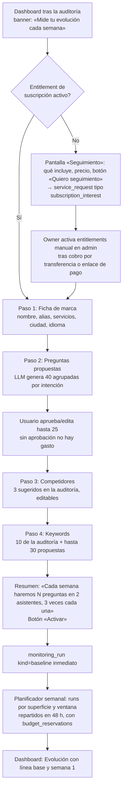
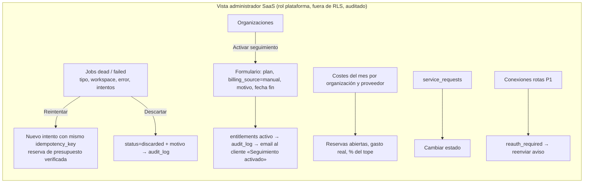

# 07 — Flujos de usuario y pantallas

**Versión:** 1 (2026-10-25). **Estado:** PROPUESTO, pendiente de revisión cruzada.
**Depende de:** `02-prd.md` (RF-xx), `03-mvp-scope.md` (niveles), `05-data-model.md` (entidades), `06-api-contracts.md`.

Principio de diseño: el usuario primario es un propietario de pyme. Cada pantalla abre con una frase que responde «¿cómo estoy?» y una que responde «¿qué hago?». Los detalles técnicos están siempre un clic por debajo.

## 1. Flujos

### 1.1 Auditoría de pago (P0)

```mermaid
sequenceDiagram
    autonumber
    actor U as Propietario
    participant L as Landing (pública)
    participant W as Web (Next.js)
    participant S as Stripe Checkout
    participant Q as Cola (jobs)
    participant K as Worker
    participant P as Proveedores (PSI, DataForSEO)
    participant M as Email (Resend)

    U->>L: Introduce dominio, email, sector, ciudad, ¿negocio local?
    L->>W: POST formulario (RF-A01)
    W->>W: Normaliza dominio, valida, crea audits(status=awaiting_payment)
    W->>S: Crea Checkout Session (metadata: audit_id, email)
    W-->>U: Redirige a Stripe
    U->>S: Paga
    S->>W: Webhook checkout.session.completed (firma verificada)
    W->>W: payments ← succeeded (idempotente por stripe_event_id)
    W->>W: Crea organizations(kind=company), workspaces(domain), users(email), memberships(owner), entitlements(plan=audit, billing_source=stripe)
    W->>Q: Encola audit.run (idempotency_key = audit_id) con budget_reservations
    S-->>U: Página de éxito: «Tu informe llegará por email en menos de una hora»
    K->>Q: Reclama audit.run
    K->>P: Fetch portada, robots, sitemap, hasta 30 páginas (SSRF-safe)
    K->>K: Reglas → audit_findings; índice de salud técnica
    K->>P: PageSpeed Insights (portada + 3) → performance_samples
    K->>P: SERP 10 keywords top 20 → serp_positions
    K->>K: LLM genera 10 prompts + 3 competidores sugeridos
    K->>P: 10 prompts × 2 superficies × 3 reps → observations, citations
    K->>K: metric_rollups; report_snapshots (JSON congelado)
    K->>Q: Encola report.render (cola report)
    K->>K: HTML → PDF (Chromium) → reports(status=ready)
    K->>M: Email con enlace firmado (72 h) + enlace de establecimiento de contraseña
    M-->>U: Email «Tu diagnóstico de {dominio} está listo»
    U->>W: Abre enlace → informe web / descarga PDF
    U->>W: Establece contraseña (enlace de un solo uso) → sesión → Dashboard
```

Estados de `audits`: `awaiting_payment → queued → running → completed | failed | partial`. `partial` cuando una fuente externa falla pero el informe puede emitirse con la sección marcada «no disponible» (RF-A10).

Puntos de fallo y respuesta:

| Fallo | Respuesta al usuario | Respuesta operativa |
|---|---|---|
| Abandona Stripe | `audits` queda `awaiting_payment`; email de recordatorio a 24 h (P1) | Purga a 7 días |
| Webhook llega antes de que el usuario vuelva | Página de éxito consulta estado por `session_id`; no depende del orden | Idempotencia por `stripe_event_id` |
| Dominio no responde / bloquea bots | Informe con sección «No pudimos leer tu web» y pasos; sin PDF completo; reembolso manual desde admin | Job `failed` visible en admin |
| PSI o DataForSEO caídos | Sección «no disponible» en el PDF; índice reescalado con nota | Reintento 3 veces; `partial` |
| PDF > 60 s / fallo Chromium | El informe web sigue disponible; PDF «en preparación» | Alerta admin; reintento |

### 1.2 Activación del seguimiento (P0 piloto, cobro manual)



Reglas: el paso 2 es bloqueante (RF-B03); editar un prompt aprobado después crea versión y marca de ruptura (RF-B04); el resumen del paso 5 muestra el coste en «preguntas/mes» del plan, nunca en céntimos de proveedor.

### 1.3 Solicitud de propuesta desde el informe (P0)

```mermaid
sequenceDiagram
    autonumber
    actor U as Propietario
    participant R as Informe web / Dashboard
    participant W as Web
    participant N as Notificaciones (Resend + Telegram)
    actor O as Owner

    U->>R: Pulsa «Pedir propuesta de mejora» (en PDF: enlace a la misma sección web)
    R->>U: Formulario: tipo (rediseño / SEO-GEO / mantenimiento / otro), mensaje, teléfono opcional
    U->>W: Envía
    W->>W: service_requests(status=new, source=report|dashboard, workspace_id) + audit_log; rate limit por workspace
    W->>N: Email al owner + Telegram (fallo de uno no bloquea el otro)
    N-->>O: «Nueva solicitud: {dominio}, {tipo}»
    W-->>U: «Te contactaremos en 2 días laborables»
    O->>W: Admin → lista de solicitudes → cambia estado (contacted / won / lost)
```

Lo que **no** hay: pipeline, tareas, notas, recordatorios. El owner gestiona la venta fuera (en `lead-platform` si quiere; exportación por webhook P2).

### 1.4 Conexión de Search Console (P1)

```mermaid
sequenceDiagram
    autonumber
    actor U as Usuario (admin del workspace)
    participant W as Web
    participant G as Google OAuth
    participant K as Worker

    U->>W: Ajustes del workspace → «Conectar Search Console»
    W->>W: Genera state firmado (sesión, workspace, operación) + PKCE
    W-->>U: Redirige a Google con scope webmasters.readonly, access_type=offline
    U->>G: Consiente
    G->>W: Callback con code + state
    W->>W: Valida state; intercambia code; cifra refresh token (AES-256-GCM, key_version) en integrations
    W->>G: Lista propiedades del usuario
    W-->>U: Selector: «¿Qué propiedad corresponde a {dominio}?» (preselecciona la que coincide)
    U->>W: Elige propiedad
    W->>W: integrations.status=active, external_id=propiedad
    W->>K: Encola gsc.backfill (16 meses, serializado por workspace)
    K->>K: search_daily por día; relectura de ventana D-3 en el job diario
    Note over W,K: Token revocado → integrations.status=reauth_required → banner en dashboard + email
```

Hechos sobre Google: scope `webmasters.readonly` y modo *Testing* con ≤ 100 usuarios sin verificación → UNVERIFIED (afirmado por Claude 2026-10-25; comprobar en Cloud Console antes de P1). Retraso de datos de GSC 2–3 días → UNVERIFIED (Claude).

### 1.5 Vista admin: job muerto y entitlement manual (P0)



## 2. Pantalla Overview: primer vistazo

Textos literales de las cuatro tarjetas (RF-C01). `{…}` son valores; la segunda línea de cada tarjeta es la lectura para propietario; la tercera, el metadato obligatorio.

| Tarjeta | Título | Cifra | Lectura | Pie (metadatos) |
|---|---|---|---|---|
| 1 | **Salud técnica de tu web** | `{índice}/100` · `{delta}` | «{n_critical} problemas graves y {n_warning} avisos en {pages_audited} páginas» | «Índice propio v{methodology_version}. Auditado el {fecha}. Público» |
| 2 | **Te mencionan los asistentes de IA** | `{presencia} %` · `{delta}` | «Apareces en {k} de {n} respuestas a {p} preguntas de clientes» | «ChatGPT (interfaz) y Google AI Overviews, por separado. {n} muestras, España, es. Preguntas v{prompt_set_version}» |
| 3 | **Tu cuota frente a competidores** | `{cuota} %` · `{delta}` | «De las veces que la IA nombra a alguno de vosotros, a ti te nombra {cuota} %» | «Panel: tú + {competidores}. {n} respuestas. Sin datos si nadie aparece» |
| 4 | **Posición en Google** | `{pos_media}` · `{delta}` | «{top10} de {keywords} búsquedas en la primera página; {ausentes} fuera del top 20» | «SERP observada, España, móvil. Estimación de proveedor. {fecha}» |

Reglas de las tarjetas: delta solo si hay ventana anterior (si no: «Primera medición»); si los intervalos se solapan, el delta se muestra en gris con «sin cambio significativo»; si cobertura operativa < 80 %, cinta «Muestra incompleta esta semana ({cobertura} %)».

Bloque bajo las tarjetas, **«Esta semana»**, tres párrafos generados por reglas (no LLM en P0):

- **Qué cambió**: «Tu presencia en ChatGPT pasó de 2 de 9 a 4 de 9 respuestas. En Google AI Overviews no hubo cambios. Dos problemas graves siguen abiertos: {hallazgo 1}, {hallazgo 2}.»
- **Sobre qué muestra**: «25 preguntas, 2 asistentes, 3 repeticiones = 150 respuestas programadas; obtuvimos 147 (98 %). 30 búsquedas en Google. Las preguntas no han cambiado desde el {fecha}.»
- **Qué merece revisar**: «1) Arreglar {hallazgo crítico} (impacto alto, esfuerzo bajo). 2) {competidor} aparece en 6 preguntas donde tú no: {lista}. 3) Tu web no es fuente citada en ninguna respuesta: revisa la página {url}.» → enlaces a Recomendaciones.

Debajo: dos CTA, «Ver recomendaciones» y «Pedir propuesta de mejora».

## 3. Inventario de pantallas

Estados obligatorios en todas las pantallas autenticadas: **cargando** (esqueleto), **vacío** (texto que dice qué hacer para que haya datos), **error** (mensaje + reintento + referencia de soporte), **muestra incompleta** cuando aplica.

### 3.1 Públicas

| Ruta | Pantalla | Elementos mínimos | Nivel |
|---|---|---|---|
| `/` | Landing | Promesa en una frase; formulario de auditoría (dominio, email, sector, ciudad, ¿negocio local?); precio `P_AUDIT`; ejemplo de informe (PDF de un dominio propio); FAQ de 5 preguntas; política de privacidad y condiciones | P0 |
| `/auditoria/exito` | Éxito de pago | Estado de la auditoría por `session_id` (en cola / en curso / lista); «te llegará por email» | P0 |
| `/auditoria/cancelada` | Pago cancelado | Volver al formulario con datos conservados | P0 |
| `/r/{token}` | Informe web por enlace firmado | Informe completo (8 secciones), botón PDF, botón «Pedir propuesta», botón «Crear contraseña y entrar» | P0 |
| `/auth/establecer` | Establecer contraseña (enlace de un solo uso) | Contraseña + confirmación; errores de enlace usado/caducado | P0 |
| `/auth/entrar`, `/auth/olvide`, `/auth/reset` | Login, olvido, reset | Email + contraseña; rate limit visible tras 5 intentos | P0 |
| `/invitacion/{token}` | Aceptar invitación | Nombre + contraseña | P0 |
| `/gratis` | Auditoría gratuita reducida | Solo portada, sin IA; rate limit por IP y dominio | P1 |

### 3.2 Autenticadas (workspace)

| Ruta | Pantalla | Elementos mínimos | Vacío | Nivel |
|---|---|---|---|---|
| `/w/{ws}` | Overview | 4 tarjetas; bloque «Esta semana»; 2 CTA | «Tu diagnóstico está en curso» con progreso por fases | P0 |
| `/w/{ws}/seo` | SEO | Hallazgos por categoría/severidad, filtro, evidencia, página afectada; tabla de keywords con posición y cambio; (P1) bloque GSC | «Sin auditoría todavía» | P0 |
| `/w/{ws}/ia` | Visibilidad IA | Tabla prompt × superficie: presencia, cita propia, `n`, ejemplo de respuesta; bloque aparte «Preguntas sobre tu marca»; filtro por intención | «Aprueba tus preguntas para empezar» → asistente | P0 |
| `/w/{ws}/competidores` | Competidores | Cuota de voz por marca y superficie; dominios más citados (propio/competidor/otro); editar panel (máx. 3) | «Añade competidores» | P0 |
| `/w/{ws}/evolucion` | Evolución | 4 series semanales con intervalo; marcas de ruptura con tooltip («Cambiaste 3 preguntas el {fecha}»); selector de superficie | «Necesitamos dos semanas para dibujar una tendencia» | P0 |
| `/w/{ws}/recomendaciones` | Recomendaciones | Lista priorizada: acción, por qué, impacto, esfuerzo, hallazgo origen, estado (pendiente/hecho, manual); CTA «Pedir propuesta» | «Sin hallazgos abiertos» | P0 |
| `/w/{ws}/informes` | Informes | Lista: fecha, tipo (auditoría / mensual), estado, PDF, renovar enlace | «Tu primer informe aparecerá aquí» | P0 |
| `/w/{ws}/seguimiento` | Asistente de activación | Pasos 1–5 de §1.2; indicador de progreso; resumen final | — | P0 |
| `/w/{ws}/ajustes` | Ajustes del workspace | Ficha de marca; alias; dominios; país/idioma; (P1) conexiones GSC/GA4; (P1) exportar/borrar | — | P0 |
| `/org/{org}` | Organización | Miembros, invitaciones, plan y límites (lectura), (P1) facturación/Customer Portal | — | P0 |
| `/org/{org}/workspaces` | Vista agencia | Lista con semáforo de las 4 cifras, última medición, cobertura, alertas | «Crea tu primer workspace» | P1 |

### 3.3 Administración de plataforma

| Ruta | Pantalla | Elementos mínimos | Nivel |
|---|---|---|---|
| `/admin` | Salud | Profundidad de cola por `queue`; jobs `dead`/h; coste del día por proveedor; conexiones rotas (P1) | P0 |
| `/admin/organizaciones` | Organizaciones | Lista; detalle: workspaces, entitlements, activar/suspender manual con motivo | P0 |
| `/admin/costes` | Costes | Por organización y proveedor: reservado, gastado, % del tope, mes actual y anterior | P0 |
| `/admin/jobs` | Jobs | Filtros por estado/tipo/workspace; reintentar; descartar con motivo | P0 |
| `/admin/solicitudes` | Solicitudes | `service_requests` con estado editable, contacto, mensaje, workspace | P0 |
| `/admin/auditorias` | Auditorías | Estado, duración, coste, reembolso manual (nota, fuera de Stripe en P0) | P0 |

## 4. Permisos (rol × acción)

Roles: **platform_admin** (owner del SaaS; fuera de RLS solo en `/admin`), **owner** y **admin** de organización, **member** de organización, **viewer de workspace** (P1, vía `workspace_grants` con rol `viewer`). En P0 todos los miembros ven todos los workspaces de su organización.

| Acción | platform_admin | owner | admin | member | viewer (P1) |
|---|---|---|---|---|---|
| Ver dashboard del workspace | ✔ (auditado) | ✔ | ✔ | ✔ | ✔ |
| Descargar informe | ✔ | ✔ | ✔ | ✔ | ✔ |
| Pedir propuesta | — | ✔ | ✔ | ✔ | ✔ |
| Editar ficha de marca, alias, competidores, keywords | — | ✔ | ✔ | ✔ | — |
| Aprobar/editar prompts (crea versión) | — | ✔ | ✔ | — | — |
| Activar asistente de seguimiento | — | ✔ | ✔ | — | — |
| Conectar/desconectar GSC (P1) | — | ✔ | ✔ | — | — |
| Invitar/eliminar miembros, cambiar roles | — | ✔ | ✔ (no puede tocar al owner) | — | — |
| Crear workspace (agencia, P1) | — | ✔ | ✔ | — | — |
| Ver plan y límites | — | ✔ | ✔ | ✔ | — |
| Gestionar facturación / Customer Portal (P1) | — | ✔ | — | — | — |
| Exportar / borrar workspace (P1) | ✔ (auditado) | ✔ | — | — | — |
| Transferir organización | — | ✔ | — | — | — |
| Activar entitlement manual, reintentar jobs, ver costes globales | ✔ | — | — | — | — |
| Cambiar estado de `service_requests` | ✔ | — | — | — | — |

Reglas: toda mutación se autoriza en servidor con comprobación de membresía, rol y entitlement, nunca por estado del cliente; el rol `platform_admin` no se concede a usuarios de clientes; cada acción de `platform_admin` sobre datos de clientes escribe `audit_log` con actor y motivo.

## Notas de coherencia

- `service_request` de tipo `subscription_interest` (flujo 1.2) amplía la lista de tipos de RF-F01 (`redesign | seo_geo | maintenance | other`); se propone añadirlo a `02` y `05` en la siguiente versión.
- La pantalla `/gratis` corresponde a RF-F04 (P1); el recordatorio a 24 h por pago abandonado es P1 y no está en `03`: se anota como propuesta, no como requisito.
- Los textos de la pantalla Overview asumen 2 superficies y 3 repeticiones (150 respuestas programadas/semana), coherente con `03` y con el desacuerdo D1 de `00`; si el piloto sube a 5 repeticiones, solo cambia el número.
