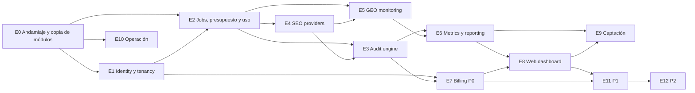

# 10 — Backlog de implementación

**Versión:** 1 (2026-10-25). **Estado:** PROPUESTO, pendiente de revisión cruzada (`13-codex-review.md`).
**Modo:** diseño. Ninguna historia autoriza implementación hasta que el owner levante el NORTE de mantenimiento del workspace (VERIFIED: `.sdd-workspace/NORTE.md:6-7`) y firme la arquitectura.

## 1. Convenciones

- **Épica** = un módulo del monolito (`identity`, `audit-engine`, `seo-providers`, `geo-monitoring`, `metrics-reporting`, `billing`, `web`) o un bloque transversal.
- **HU-xx** = historia. Las P0 llevan los seis campos exigidos: resultado esperado, dependencias, criterios de aceptación, pruebas necesarias, prioridad y estimación justificada. Las P1/P2 van en una línea con estimación gruesa.
- **Estimación** = jornadas de 8 h de un desarrollador senior asistido por agentes, incluyendo tests y revisión; excluye esperas del owner, de Google y de proveedores. Rango, no cifra.
- **Pruebas**: `unit` (sin BD), `integration` (Vitest contra PostgreSQL real, como en `lead-platform`, VERIFIED `vitest.config.ts`), `isolation` (suite de aislamiento RLS copiada de `tests/isolation/tenant-isolation.test.ts`, VERIFIED existencia), `e2e` (Playwright).
- Vocabulario de entidades y módulos: `00-analysis-comparison.md` §7 y `05-data-model.md`.

## 2. Grafo de dependencias entre épicas

Camino crítico P0: E0 → E1 → E2 → E4 → E3 → E6 → E7 → E8 → E9, con E5 y E10 en paralelo a E3/E6.

## 3. Épicas e historias

### E0 — Andamiaje del repositorio y copia de módulos

**Objetivo:** repo `visibility-platform` arrancable, con los módulos sin dominio de `lead-platform` copiados y documentados.

#### HU-01 · Esqueleto Next.js + TypeScript + Drizzle + Vitest + Playwright (P0)

- **Resultado esperado:** `npm run dev`, `npm run build`, `npm test` y `npm run worker` funcionan en un repo vacío de dominio; `CONSTITUTION.md` propio del producto (no el de `lead-platform`); `.nvmrc` Node 22.
- **Dependencias:** ninguna.
- **Criterios de aceptación:**
  - Dado el repo clonado y `.env.example` copiado, `npm ci && npm run build` termina sin errores.
  - `npm test` ejecuta al menos un test de integración contra PostgreSQL real y pasa.
  - `drizzle-kit generate` produce la migración `0000` con las tablas de E1 vacías de datos.
  - El `CONSTITUTION.md` fija: sin Redis/BullMQ, sin microservicios, sin imports de `lead-platform`, librería de gráficas permitida.
- **Pruebas necesarias:** `integration` (smoke de conexión a BD); test de arranque que falla si existe cualquier import a `@lead-platform` o ruta de `../lead-platform`.
- **Prioridad:** P0.
- **Estimación:** 1,5–2 j. Configuración conocida (mismo stack que `lead-platform`, VERIFIED `package.json`), pero hay que escribir la constitución y el `.env.example` desde cero.

#### HU-02 · Copia con procedencia de módulos sin dominio (P0)

- **Resultado esperado:** `src/lib/{jobs,secrets,db/with-scope,email,errors}` copiados de `lead-platform@983dfb6`, adaptados al nombre `workspace_id`, con `COPIED_FROM.md` que lista fichero origen, SHA y cambios aplicados; scripts `infra/{deploy.sh,backup-lib.sh,restore-drill.sh}` parametrizados por BD.
- **Dependencias:** HU-01.
- **Criterios de aceptación:**
  - `COPIED_FROM.md` tiene una fila por fichero copiado con SHA de origen `983dfb6` y lista de modificaciones.
  - Ningún fichero copiado importa de `src/lib/crm` ni de `src/lib/console` (ADR-004).
  - Los tests que acompañaban a los módulos en origen pasan en el nuevo repo tras la adaptación.
- **Pruebas necesarias:** `unit` (crypto: cifrar/descifrar con dos versiones de clave); `integration` (cola: claim atómico con dos workers concurrentes, backoff, dead-letter); lint de imports prohibidos.
- **Prioridad:** P0.
- **Estimación:** 2–3 j. Copiar es rápido; adaptar `withTenant` a `withWorkspace` y revisar cada test es lo que cuesta. Coincide con el «andamiaje 4–6 j» de Claude sumado a HU-01.

### E1 — Identity y tenancy

**Objetivo:** organizaciones, usuarios, membresías y workspaces con aislamiento RLS por `workspace_id`.

#### HU-03 · Modelo `organizations`, `users`, `memberships`, `workspaces`, `workspace_grants` con RLS (P0)

- **Resultado esperado:** migración con las cinco tablas, `organization_id` desnormalizado en `workspaces` y en toda tabla de negocio, políticas RLS por `workspace_id`, función `withWorkspace(workspaceId, fn)` que fija `app.workspace_id` y cambia al rol `app_workspace`.
- **Dependencias:** HU-02.
- **Criterios de aceptación:**
  - Dado un workspace A y otro B en organizaciones distintas, cuando una consulta dentro de `withWorkspace(A)` pide filas de B, entonces recibe cero filas y ninguna escritura afecta a B.
  - Dado un UUID inválido, `withWorkspace` lanza error antes de abrir transacción.
  - Una consulta fuera de `withWorkspace` en código de aplicación (no admin) falla el lint `no-unscoped-db` (regla de ESLint propia).
  - El rol de administrador de plataforma consulta fuera de RLS solo mediante `withPlatformAdmin()` que escribe en `audit_log`.
- **Pruebas necesarias:** `isolation` (suite copiada y ampliada a todas las tablas de E1); `integration` (FK compuestas rechazan referencias cruzadas); `unit` (validación de UUID).
- **Prioridad:** P0.
- **Estimación:** 2–3 j. El patrón está probado (VERIFIED `with-tenant.ts`), pero añadir `organization_id` desnormalizado, grants y la auditoría del acceso admin es nuevo.

#### HU-04 · Registro, login con contraseña, sesión en BD, invitación por enlace (P0)

- **Resultado esperado:** páginas `/signup`, `/signin`, `/invite/[token]`, `/forgot`, `/reset`; contraseñas scrypt; cookie firmada con solo el id de sesión; TTL 12 h; invitaciones de un solo uso de 48 h por email; rate limit de auth en Postgres.
- **Dependencias:** HU-03.
- **Criterios de aceptación:**
  - Un usuario puede pertenecer a dos organizaciones y cambiar entre ellas sin volver a autenticarse.
  - Un token de invitación usado dos veces falla la segunda vez.
  - Seis intentos fallidos de login en 10 minutos desde la misma IP y email devuelven 429.
  - Ninguna cookie contiene email, id de usuario ni rol.
- **Pruebas necesarias:** `integration` (ciclo completo signup → invitación → aceptación → cambio de organización); `unit` (hash y verificación scrypt, firma de cookie); `e2e` (login y logout).
- **Prioridad:** P0.
- **Estimación:** 3–4 j. Se **reescribe**, no se copia (ADR-004): el modelo de `lead-platform` es un usuario por tenant (INFERRED, ambos informes) y aquí hace falta membresía multi-organización.

- **HU-05** · Magic link por email (P1) — 1 j.
- **HU-06** · `workspace_grants` para limitar a un miembro a un subconjunto de workspaces (P1) — 1,5 j.

### E2 — Jobs, presupuesto y uso

**Objetivo:** cola Postgres con idempotencia, colas lógicas, reserva de presupuesto y registro de coste por llamada.

#### HU-07 · Cola con `idempotency_key`, columna `queue` y concurrencia por proveedor (P0)

- **Resultado esperado:** tabla `jobs` copiada con columnas `idempotency_key UNIQUE`, `queue` (`audit | ingest | observe | report`), `provider`, `provider_task_id`; worker que procesa una cola cada vez con `max_in_flight` por proveedor leído de configuración tipada.
- **Dependencias:** HU-02, HU-03.
- **Criterios de aceptación:**
  - Encolar dos veces el mismo `idempotency_key` deja un único job y devuelve el existente.
  - Con `max_in_flight.dataforseo = 5`, nunca hay más de 5 jobs `running` con `provider = dataforseo` (test con 20 jobs y 3 workers simulados).
  - Un job con `provider_task_id` guardado que falla por timeout pasa a estado `reconcile`, no a reintento inmediato.
  - Un `TerminalJobError` manda el job a `dead` en el primer intento.
- **Pruebas necesarias:** `integration` (claim concurrente, idempotencia, límites, reconcile); `unit` (clasificación de errores `retryable | terminal`).
- **Prioridad:** P0.
- **Estimación:** 2–3 j. La cola existe (VERIFIED `jobs.ts:93` `SKIP LOCKED`); lo nuevo es idempotencia por job, colas lógicas y el estado `reconcile` que pide Codex.

#### HU-08 · `provider_pricing`, `usage_events`, `budget_reservations` y tope duro por workspace (P0)

- **Resultado esperado:** precios unitarios por proveedor y operación en tabla versionada; cada llamada externa escribe un `usage_event` con coste real (también en fallo); encolar una operación de pago reserva presupuesto en la misma transacción; al completar se registra el coste real y se libera la diferencia; `check:pricing` falla el deploy si falta precio para una operación usada.
- **Dependencias:** HU-07.
- **Criterios de aceptación:**
  - Dado un workspace con tope 5,00 € y reservas por 4,80 €, encolar una operación de 0,30 € falla con `BudgetExceeded` y no crea job.
  - Dado un job completado con coste real menor que la reserva, la diferencia vuelve a estar disponible.
  - Un job fallido tras llamar al proveedor deja un `usage_event` con coste y `status = failed`.
  - Vista admin muestra reservado, consumido y disponible por workspace y mes.
- **Pruebas necesarias:** `integration` (reserva concurrente desde dos transacciones no supera el tope); `unit` (cálculo de coste por operación y moneda); test de cobertura de precios en CI.
- **Prioridad:** P0.
- **Estimación:** 2,5–3,5 j. El presupuesto de `lead-platform` existe (VERIFIED `budget.ts:47`) pero según Codex no reserva antes de gastar (INFERRED); se reescribe con reserva transaccional.

### E3 — Audit engine

**Objetivo:** auditoría acotada de un dominio (ADR-013) que produce `audits`, `audit_pages`, `audit_findings` y `performance_samples`.

#### HU-09 · `AuditFetcher` seguro contra SSRF con descubrimiento acotado (P0)

- **Resultado esperado:** fetcher que normaliza el dominio, resuelve DNS, rechaza IPs privadas/loopback/link-local y metadata (169.254.x), limita a 5 redirecciones comprobando cada salto, 2 MB por página, 15 s por petición, `User-Agent` identificable, respeta `robots.txt`; descubre portada, `robots.txt`, `sitemap.xml` (incl. index de sitemaps) y hasta 30 URLs del mismo host.
- **Dependencias:** HU-07.
- **Criterios de aceptación:**
  - Dado `http://127.0.0.1`, `http://169.254.169.254`, `http://[::1]` o un host que resuelve a 10.0.0.1, el fetcher rechaza antes de conectar.
  - Dada una redirección de un host público a una IP privada, se rechaza en el salto.
  - Dado un sitemap con 500 URLs, se eligen 30 con prioridad a profundidad 1–2 y se registra `truncated = true`.
  - Dado un `robots.txt` que bloquea `/privado/`, esa ruta no se descarga.
- **Pruebas necesarias:** `unit` (validador de destino con tabla de rangos, parser de robots y sitemap); `integration` (servidor HTTP local con redirecciones y sitemap; comprobar límites); `e2e` no aplica.
- **Prioridad:** P0.
- **Estimación:** 2–3 j. La protección SSRF es la parte delicada y está marcada P0 por Codex y por el encargo (entrada externa).

#### HU-10 · Analizadores on-page y de indexabilidad con `audit_findings` tipados (P0)

- **Resultado esperado:** reglas que producen findings con `code`, `severity`, `pages[]`, `evidence` para: title/description (ausente, longitud, duplicado), H1 (ausente, múltiple), meta robots y `X-Robots-Tag`, códigos de estado y cadenas de redirección, canonical (ausente, no autorreferente, apunta a 3xx/4xx), sitemap (URLs no 200, bloqueadas por robots), JSON-LD (sintaxis, tipos presentes), HTTPS/www, `hreflang` básico, NAP/`LocalBusiness` si `is_local`.
- **Dependencias:** HU-09.
- **Criterios de aceptación:**
  - Cada regla tiene al menos un fixture HTML que la dispara y otro que no.
  - Un sitio de prueba con 12 problemas conocidos produce exactamente esos 12 `codes` (sin falsos positivos en el fixture limpio).
  - Cada finding incluye la clasificación `public | third_party_estimate | owner_required` de su fuente.
  - JSON-LD inválido se reporta con la posición del error, sin abortar la auditoría.
- **Pruebas necesarias:** `unit` por regla con fixtures; `integration` (auditoría completa sobre el servidor local de HU-09 produce `audit_pages` y `audit_findings`).
- **Prioridad:** P0.
- **Estimación:** 4–5 j. Unas 20 reglas con fixtures; es trabajo nuevo que ningún informe estimó.

#### HU-11 · Índice de salud técnica con fórmula publicada (P0)

- **Resultado esperado:** función pura `computeHealthIndex(findings) → { score, breakdown }` con pesos por categoría definidos en `02-prd.md`; el `breakdown` se guarda en `audits` y se imprime en el informe.
- **Dependencias:** HU-10.
- **Criterios de aceptación:**
  - Sin findings → 100; solo findings `info` → ≥ 90; un `critical` de indexabilidad en portada → ≤ 60 (valores fijados por la fórmula del PRD).
  - El `breakdown` suma exactamente el `score`.
  - Cambiar un peso cambia la versión `rules_version` almacenada en `audits`.
- **Pruebas necesarias:** `unit` (tabla de casos); test de regresión que falla si la fórmula cambia sin subir versión.
- **Prioridad:** P0.
- **Estimación:** 0,5–1 j. Función pura; el coste está en acordar los pesos.

#### HU-12 · Orquestación de la auditoría como job (P0)

- **Resultado esperado:** handler `audit.run` que ejecuta fetch → análisis → PSI (E4) → SERP de 10 keywords (E4) → muestra IA de 10 prompts (E5) → `health index` → encola `report.generate`; estado de `audits` (`queued | fetching | analyzing | sampling | reporting | done | failed`) visible al usuario; fallo parcial de un proveedor marca la sección como `incomplete` sin abortar.
- **Dependencias:** HU-10, HU-11, HU-14, HU-15, HU-18.
- **Criterios de aceptación:**
  - Dado DataForSEO no disponible, la auditoría termina `done` con la sección IA marcada `incomplete` y motivo.
  - Reencolar `audit.run` con el mismo `idempotency_key` no repite llamadas de pago (comprobado por `usage_events`).
  - Una auditoría de 30 páginas en el servidor local termina en < 10 min de reloj con fakes de proveedores.
- **Pruebas necesarias:** `integration` (pipeline completo con fakes); `integration` (fallo parcial); `e2e` (estado visible en la página de la auditoría).
- **Prioridad:** P0.
- **Estimación:** 2–3 j.

- **HU-13** · Enlaces rotos internos, `alt` de imágenes, peso de página (P1) — 1,5 j.

### E4 — SEO providers

**Objetivo:** interfaces intercambiables con adaptadores reales y fakes.

#### HU-14 · `SerpProvider` con adaptador DataForSEO y fake (P0)

- **Resultado esperado:** interfaz `fetchTop({ keyword, locale, location, device, depth })` → resultados orgánicos y bloque AI Overview si existe; adaptador DataForSEO (modo estándar asíncrono: crear tarea, guardar `provider_task_id`, recoger resultado); fake determinista para tests; cada resultado con `provider`, `provider_ref`, `cost_cents`, `captured_at`, `normalizer_version`.
- **Dependencias:** HU-07, HU-08.
- **Criterios de aceptación:**
  - Dado un `provider_task_id` guardado y un reinicio del worker, el resultado se recoge sin crear una tarea nueva.
  - La respuesta cruda se guarda en `observations.raw` (jsonb) y la normalizada en `serp_positions`.
  - Un cambio de versión del normalizador no reescribe filas antiguas.
- **Pruebas necesarias:** `unit` (normalizador con fixtures reales anonimizados); `integration` (flujo crear/recoger con servidor mock HTTP); test de contrato que el fake y el adaptador real comparten.
- **Prioridad:** P0.
- **Estimación:** 2–3 j. Capacidades y precios de DataForSEO: UNVERIFIED en esta sesión (ambos informes los leyeron el 2026-10-25).

#### HU-15 · `PerformanceProvider` con adaptador PageSpeed Insights y fake (P0)

- **Resultado esperado:** interfaz `measure({ url, strategy })` → métricas de laboratorio (LCP, CLS, INP/TBT, FCP) y de campo CrUX si existen; adaptador PSI con clave de API y cola `audit` limitada por `max_in_flight`; `performance_samples` por URL y estrategia (mobile/desktop).
- **Dependencias:** HU-07, HU-08.
- **Criterios de aceptación:**
  - Portada + 3 páginas × 2 estrategias = 8 muestras por auditoría, o menos con `incomplete` si PSI falla.
  - Sin datos CrUX, el campo se marca `unavailable`, no cero.
  - Cuota agotada (429) clasifica como `retryable` con backoff ≥ 60 s.
- **Pruebas necesarias:** `unit` (mapeo de respuesta PSI con fixtures); `integration` (429 y backoff).
- **Prioridad:** P0.
- **Estimación:** 1–1,5 j. Cuota y términos de PSI: UNVERIFIED; condición previa en `11-risks`.

- **HU-16** · Segundo adaptador SERP (Serper) para contingencia (P1) — 1 j.
- **HU-17** · `SearchPerformanceProvider` GSC (P1, ver E11).

### E5 — GEO monitoring

**Objetivo:** prompts versionados, ejecuciones periódicas en dos superficies, observaciones, menciones, citas y agregados.

#### HU-18 · `AnswerObservationProvider` con adaptador DataForSEO LLM Scraper (ChatGPT) y AIO vía SERP, más fake (P0)

- **Resultado esperado:** interfaz `observe({ prompt, locale, country, surface })` → `{ text, citations[], raw, cost_cents, provider_ref, capture_condition }`; adaptadores `chatgpt` (`ui_scraper`) y `google_aio` (`serp`, reutiliza HU-14); fake con respuestas deterministas que mencionan marcas configurables.
- **Dependencias:** HU-14.
- **Criterios de aceptación:**
  - Cada observación lleva `surface`, `capture_condition`, `country`, `locale`, `engine_version` (si el proveedor lo informa) y `prompt_version_id`.
  - Un timeout tras crear la tarea externa deja el job en `reconcile` con `provider_task_id`.
  - Sin AI Overview en la SERP, la observación existe con `has_answer = false` (cuenta como válida en el denominador de cobertura operativa, no como presencia).
- **Pruebas necesarias:** `unit` (normalizador por superficie); `integration` (mock HTTP: éxito, timeout, reconcile); contrato compartido fake/real.
- **Prioridad:** P0.
- **Estimación:** 2,5–3,5 j. Capacidad del LLM Scraper para ChatGPT: UNVERIFIED (ambos informes la documentan como anunciada por DataForSEO).

#### HU-19 · Generación asistida, aprobación y versionado de prompts (P0)

- **Resultado esperado:** acción `generatePromptCandidates` que pide a un LLM 40 preguntas por intención (`discovery | comparison | recommendation | decision | branded`) a partir de la ficha del workspace; UI para aprobar/editar hasta 25; cada cambio de texto, intención o mercado crea `prompts.version + 1` con `parent_id`; las series marcan la ruptura.
- **Dependencias:** HU-03, HU-08.
- **Criterios de aceptación:**
  - Sin al menos un prompt `approved` no se puede activar el seguimiento.
  - Editar un prompt aprobado crea una versión nueva y retira la anterior; las observaciones antiguas conservan su `prompt_version_id`.
  - Los prompts `branded` se excluyen del cálculo de cuota de voz.
  - La llamada al LLM se registra en `usage_events` con coste.
- **Pruebas necesarias:** `unit` (versionado, exclusión de branded); `integration` (generación con LLM fake, aprobación, límite 25); `e2e` (pantalla de aprobación).
- **Prioridad:** P0.
- **Estimación:** 2–3 j.

#### HU-20 · `monitoring_runs` semanales con reparto en 48 h e idempotencia por unidad lógica (P0)

- **Resultado esperado:** scheduler (job autoreencolado, como `retention.sweep` de `lead-platform`, VERIFIED patrón) que cada semana crea un `monitoring_run` por workspace activo y encola `observe.*` jobs con `idempotency_key = workspace + prompt_version + surface + run_window + repetition`, repartidos en 48 h, 3 repeticiones; línea base al activar el seguimiento.
- **Dependencias:** HU-18, HU-19, HU-08.
- **Criterios de aceptación:**
  - Ejecutar el scheduler dos veces en la misma ventana no crea jobs duplicados.
  - 25 prompts × 2 superficies × 3 repeticiones = 150 jobs por run, con `scheduled_for` distribuidos en 48 h.
  - Un run con presupuesto insuficiente se crea con estado `budget_blocked` y aviso, sin encolar.
  - `monitoring_runs.coverage = obtenidas / programadas` se actualiza al cerrar.
- **Pruebas necesarias:** `integration` (idempotencia del scheduler, reparto temporal, bloqueo por presupuesto).
- **Prioridad:** P0.
- **Estimación:** 2–3 j.

#### HU-21 · Detección determinista de menciones y extracción de citas (P0)

- **Resultado esperado:** función pura que, dado el texto normalizado (minúsculas, sin acentos, sin puntuación) y la lista de marcas con alias, devuelve menciones por marca (máximo una por respuesta) y posición del primer carácter; extracción de URLs citadas → `citations` con dominio normalizado y clasificación `own | competitor | other`.
- **Dependencias:** HU-18.
- **Criterios de aceptación:**
  - Alias de menos de 4 caracteres exigen coincidencia de palabra completa; se avisa al configurarlos.
  - «Clínica Dental Sonrisa» se detecta en «clinica dental sonrisa» y «ClínicaDentalSonrisa»; no se detecta en «sonrisas».
  - URLs con `utm_*` y `www.` se normalizan al mismo dominio.
  - Conjunto de 50 respuestas etiquetadas a mano: precisión ≥ 0,95 y exhaustividad ≥ 0,90.
- **Pruebas necesarias:** `unit` (tabla de casos, dataset etiquetado en `tests/fixtures/mentions`).
- **Prioridad:** P0.
- **Estimación:** 1,5–2 j.

#### HU-22 · `metric_rollups` semanales con las cinco métricas y denominadores (P0)

- **Resultado esperado:** job `rollup.compute` que, al cerrar un run, calcula por workspace, superficie y versión de cohorte: presencia de marca, tasa de cita, cuota de voz entre marcas seguidas, cobertura de preguntas y cobertura operativa, guardando numerador, denominador y nº de muestras; también posición media SERP por keyword.
- **Dependencias:** HU-20, HU-21.
- **Criterios de aceptación:**
  - Cada fila de `metric_rollups` contiene `numerator`, `denominator`, `sample_size`, `methodology_version`.
  - Las métricas de dos superficies nunca se promedian en una sola fila.
  - Recalcular el rollup de un periodo cerrado da el mismo resultado (determinismo).
  - Un cambio de versión de prompts abre una cohorte nueva; no se recalcula la anterior.
- **Pruebas necesarias:** `unit` (fórmulas con casos límite: cero respuestas válidas, todas branded); `integration` (rollup desde observaciones de fixture).
- **Prioridad:** P0.
- **Estimación:** 2–2,5 j.

- **HU-23** · Sugerencia de competidores por dominios más citados (P1) — 1 j.
- **HU-24** · Verificación HTTP de citas (P1) — 0,5 j.
- **HU-25** · Adaptadores Gemini UI y Perplexity API (P1) — 2 j.
- **HU-26** · Ejecuciones manuales descontadas de cuota (P1) — 1 j.

### E6 — Metrics y reporting

**Objetivo:** snapshots inmutables, plantilla HTML única, PDF y envío.

#### HU-27 · `report_snapshots` inmutables (P0)

- **Resultado esperado:** al generar un informe se congela en jsonb todo lo que el informe muestra (findings, índice, rollups, SERP, muestras IA, competidores, limitaciones, versiones de metodología); `reports` referencia el snapshot; los snapshots no se actualizan ni borran salvo borrado del workspace.
- **Dependencias:** HU-12, HU-22.
- **Criterios de aceptación:**
  - Generar el mismo informe dos veces a partir del mismo snapshot produce HTML idéntico (hash).
  - Cualquier `UPDATE` sobre `report_snapshots` falla por trigger.
  - El snapshot incluye `methodology_version`, `rules_version` y `prompt_set_version`.
- **Pruebas necesarias:** `integration` (inmutabilidad por trigger, determinismo del HTML).
- **Prioridad:** P0.
- **Estimación:** 1–1,5 j.

#### HU-28 · Plantilla HTML del informe con las ocho secciones (P0)

- **Resultado esperado:** componente React server-rendered que, dado un snapshot, produce resumen ejecutivo, situación inicial, problemas detectados, comparativa competitiva, evidencias, oportunidades, acciones recomendadas con prioridad y limitaciones de la medición; cada cifra con su fuente y clasificación `public | third_party_estimate | owner_required`; estilos de impresión.
- **Dependencias:** HU-27.
- **Criterios de aceptación:**
  - Las ocho secciones aparecen aunque una sección de datos esté `incomplete` (con el aviso correspondiente).
  - Ninguna cifra de IA aparece sin nº de muestras y superficie al lado.
  - Las acciones recomendadas salen ordenadas por `severity` y luego por páginas afectadas.
  - Lectura en pantalla y en PDF usan el mismo componente.
- **Pruebas necesarias:** `unit` (render con snapshot de fixture y comprobaciones de contenido); revisión visual manual del PDF en el checklist de release.
- **Prioridad:** P0.
- **Estimación:** 3–4 j. Redacción, estructura y diseño de impresión; es el activo comercial.

#### HU-29 · Generación de PDF con Chromium headless y enlace firmado (P0)

- **Resultado esperado:** job `report.generate` en la cola `report` que renderiza el HTML con Playwright/Chromium, guarda el PDF en almacenamiento (disco local montado en P0; S3 compatible en P1, ADR-015), registra tamaño y duración, y expone `/api/v1/reports/{id}/download?sig=...` con firma HMAC y caducidad 7 días.
- **Dependencias:** HU-28, HU-07.
- **Criterios de aceptación:**
  - 10 generaciones consecutivas en el entorno de pruebas: RAM pico < 1 GB y p95 < 60 s (umbral de D2 en `00` §6; si se supera, se abre la alternativa externa).
  - Una firma caducada o alterada devuelve 403 sin revelar si el informe existe.
  - El PDF se regenera byte a byte desde el snapshot (salvo metadatos de fecha del PDF, que se fijan).
- **Pruebas necesarias:** `integration` (generación real con Chromium en CI local); `unit` (firma y caducidad); prueba de carga manual documentada.
- **Prioridad:** P0.
- **Estimación:** 1,5–2,5 j. Riesgo de memoria en el VPS compartido (R-12).

#### HU-30 · Envío del informe por email (P0)

- **Resultado esperado:** `EmailProvider` (copiado) con plantilla «Tu informe está listo» con el enlace firmado; remitente propio del producto; registro en `audit_log`.
- **Dependencias:** HU-29.
- **Criterios de aceptación:**
  - Al pasar `reports.status = ready`, se envía exactamente un email aunque el job se reintente.
  - El email no incluye el PDF adjunto, solo el enlace firmado.
- **Pruebas necesarias:** `integration` (fake de email, idempotencia del envío).
- **Prioridad:** P0.
- **Estimación:** 0,5–1 j.

- **HU-31** · Informe mensual automático para suscriptores (P1) — 1,5 j.

### E7 — Billing P0

**Objetivo:** cobrar la auditoría con tarjeta y representar derechos de uso sin depender de Stripe para el piloto de suscripción.

#### HU-32 · Stripe Checkout de pago único y webhook (P0)

- **Resultado esperado:** formulario público → `POST /api/v1/checkout/audit` crea sesión de Checkout con `metadata = { domain, email, sector, city, is_local }`; webhook `checkout.session.completed` verificado por firma crea (o reutiliza) `users`/`organizations`/`workspaces`, registra `payments`, crea `entitlements` tipo `audit_single` y encola `audit.run`; email de bienvenida con enlace para fijar contraseña.
- **Dependencias:** HU-04, HU-12.
- **Criterios de aceptación:**
  - Ningún job `audit.run` se encola sin un `payments.status = succeeded` (la auditoría nunca corre antes de cobrar).
  - El webhook recibido dos veces produce una sola auditoría (idempotencia por `stripe_event_id`).
  - Un webhook con firma inválida devuelve 400 y se audita.
  - Flujo completo en modo test de Stripe: pago → auditoría → PDF → email.
- **Pruebas necesarias:** `integration` (webhook con eventos de fixture, idempotencia, firma); `e2e` en modo test de Stripe (manual documentado).
- **Prioridad:** P0.
- **Estimación:** 2–3 j. Stripe no existe en `lead-platform` (VERIFIED), se construye desde cero.

#### HU-33 · `entitlements` con `billing_source` y activación manual de suscripción (P0)

- **Resultado esperado:** tabla `entitlements` (`kind: audit_single | monitoring`, `billing_source: stripe | manual | bundle_lead_platform`, `limits jsonb`, `valid_from`, `valid_until`, `status`); acción admin «Activar seguimiento manual» que crea el entitlement y la línea base; el scheduler solo considera workspaces con entitlement `monitoring` activo.
- **Dependencias:** HU-03, HU-20.
- **Criterios de aceptación:**
  - Un workspace sin entitlement `monitoring` activo no recibe runs.
  - Caducar un entitlement detiene los runs siguientes sin borrar datos.
  - Los límites del entitlement (prompts, superficies, repeticiones) se aplican al crear el run.
  - Toda activación manual queda en `audit_log` con el admin que la hizo.
- **Pruebas necesarias:** `integration` (scheduler respeta entitlements; límites aplicados); `isolation` (un admin de organización no puede activar entitlements de otra).
- **Prioridad:** P0.
- **Estimación:** 1,5–2 j.

- **HU-34** · Stripe Billing: suscripción, Customer Portal, webhooks de ciclo de vida, suspensión por impago (P1) — 3–4 j.
- **HU-35** · Planes con límites = variables de coste (P1) — 1 j.

### E8 — Web dashboard

**Objetivo:** las siete pantallas P0 más la vista admin mínima.

#### HU-36 · Shell, navegación por workspace y Overview (P0)

- **Resultado esperado:** layout con selector de organización/workspace, navegación lateral, Overview con cuatro tarjetas (índice de salud, presencia IA, cuota de voz, posición media SERP), delta vs periodo anterior y nº de muestras; estados vacíos cuando aún no hay datos.
- **Dependencias:** HU-04, HU-22, HU-27.
- **Criterios de aceptación:**
  - Un usuario con dos workspaces cambia entre ellos y nunca ve datos del otro (test de aislamiento a nivel de página).
  - Cada tarjeta muestra el nº de muestras o «sin datos»; nunca un porcentaje sin denominador.
  - Tiempo de carga del Overview con 12 semanas de rollups < 1 s en local.
- **Pruebas necesarias:** `e2e` (navegación, estados vacíos, aislamiento visual); `integration` (consultas del Overview dentro de `withWorkspace`).
- **Prioridad:** P0.
- **Estimación:** 2–3 j.

#### HU-37 · Pantallas SEO, Visibilidad IA y Competidores (P0)

- **Resultado esperado:** SEO: tabla de findings por severidad con páginas y evidencia, tabla de keywords con posición y cambio. Visibilidad IA: tabla prompts × superficie con tasa de aparición, citas propias y última respuesta de ejemplo (texto 90 días). Competidores: cuota de voz por marca y dominios más citados.
- **Dependencias:** HU-36.
- **Criterios de aceptación:**
  - Filtros por superficie y por cohorte de prompts; nunca se mezclan superficies en una celda.
  - El texto de ejemplo desaparece a los 90 días y la celda indica «texto purgado».
  - Dominios citados marcados como `own | competitor | other` con colores accesibles.
- **Pruebas necesarias:** `e2e` (filtros, purga visible); `unit` (formateadores de tasa e intervalo).
- **Prioridad:** P0.
- **Estimación:** 3–4 j.

#### HU-38 · Evolución histórica, Recomendaciones e Informes (P0)

- **Resultado esperado:** Evolución: series semanales de las cuatro tarjetas con librería de gráficas ligera y marcas de ruptura por cambio de cohorte. Recomendaciones: lista priorizada por reglas (finding → acción → impacto cualitativo). Informes: lista con estado y botón de descarga por enlace firmado.
- **Dependencias:** HU-37, HU-29.
- **Criterios de aceptación:**
  - Un cambio de versión de prompts dibuja una línea vertical con etiqueta en la serie de presencia IA.
  - Cada recomendación enlaza al finding que la origina.
  - La descarga usa el enlace firmado y nunca una ruta directa al fichero.
- **Pruebas necesarias:** `e2e`; `unit` (motor de reglas de recomendaciones con tabla finding → acción).
- **Prioridad:** P0.
- **Estimación:** 2,5–3,5 j.

#### HU-39 · Vista administrador SaaS mínima (P0)

- **Resultado esperado:** páginas fuera de RLS bajo `withPlatformAdmin()`: organizaciones y entitlements, coste por organización y proveedor del mes, reservas, jobs `dead` y `reconcile`, `service_requests`, botón de activación manual (HU-33).
- **Dependencias:** HU-08, HU-33.
- **Criterios de aceptación:**
  - Solo usuarios con `platform_role = admin` acceden; cualquier acceso se audita.
  - Tabla de jobs permite reencolar o marcar como resuelto un `dead`.
- **Pruebas necesarias:** `integration` (autorización y auditoría); `e2e` (acceso denegado a usuario normal).
- **Prioridad:** P0.
- **Estimación:** 1,5–2 j.

- **HU-40** · Vista agencia: lista de workspaces con semáforo e invitaciones por workspace (P1) — 2–3 j.
- **HU-41** · Exportación CSV/JSON y borrado completo de workspace (P1) — 2 j.

### E9 — Captación comercial

#### HU-42 · `service_requests` desde informe y dashboard, con notificación al owner (P0)

- **Resultado esperado:** botón «Pedir propuesta de mejora» en el informe web y en Recomendaciones → formulario (tipo de servicio, mensaje, contacto prellenado) → `service_requests` con estado `new`; notificación por email y Telegram al owner (patrón `telegram-owner-notifier`, VERIFIED existencia en `lead-platform`); lista en la vista admin con cambio de estado `new | contacted | won | lost`.
- **Dependencias:** HU-38, HU-39.
- **Criterios de aceptación:**
  - La solicitud queda ligada al workspace y al informe desde el que se pidió.
  - Dos clics seguidos crean una sola solicitud (idempotencia por formulario).
  - No existe pipeline, tareas ni notas: solo estado y marca temporal (no es un CRM).
- **Pruebas necesarias:** `integration` (creación, notificación fake, cambio de estado); `e2e` (botón visible en informe).
- **Prioridad:** P0.
- **Estimación:** 1–1,5 j.

- **HU-43** · Landing pública con auditoría gratuita reducida y rate limit por IP/dominio (P1) — 2 j.
- **HU-44** · Webhook de `service_requests` hacia el formulario de `lead-platform` (P2) — 1 j.

### E10 — Operación

#### HU-45 · Stack compose propio, BD propia, deploy y backups (P0)

- **Resultado esperado:** `infra/docker-compose.yml` con `app` y `worker` del producto; BD `visibility` y rol propios en la instancia PostgreSQL existente; entrada Caddy `app.<dominio>`; `deploy.sh <sha>` con migración, `check:pricing`, sonda de salud y rollback; backups cifrados con `backup-lib.sh` parametrizado y `restore-drill.sh`.
- **Dependencias:** HU-01, HU-02.
- **Criterios de aceptación:**
  - Un despliegue fallido en la sonda de salud revierte a la imagen anterior.
  - El restore drill restaura la BD en un contenedor temporal y pasa un smoke test.
  - Medición de RAM del VPS antes y después del primer despliegue registrada en `docs/` (RAM libre: UNVERIFIED hoy, ambos informes).
- **Pruebas necesarias:** ensayo manual documentado (deploy, rollback, restore).
- **Prioridad:** P0.
- **Estimación:** 1,5–2 j.

#### HU-46 · Logger estructurado, Sentry, `ops_metrics` y alertas básicas (P0)

- **Resultado esperado:** pino con `workspace_id`, `job_id`, `provider`; Sentry en web y worker con scrubber de credenciales; tabla `ops_metrics` con profundidad de cola por `queue`, jobs `dead`/h, coste por proveedor/día, cobertura operativa por run; alerta por Telegram al owner si cola > 2 h, `dead` > 5/h, coste diario > 2× media o cobertura < 80 %.
- **Dependencias:** HU-07, HU-08.
- **Criterios de aceptación:**
  - Ningún log contiene tokens, claves ni texto completo de respuestas de IA.
  - Las cuatro alertas se disparan con datos sintéticos en test.
- **Pruebas necesarias:** `unit` (scrubber); `integration` (cálculo de métricas y umbrales).
- **Prioridad:** P0.
- **Estimación:** 1–1,5 j.

### E11 — P1 (SaaS comercial inicial)

Resumen; estimaciones gruesas.

| HU | Historia | Est. |
|---|---|---|
| HU-47 | OAuth Google (PKCE, `state` firmado, refresh cifrado AES-256-GCM versionado), selector de propiedad GSC, `integrations` con `reauth_required` | 3–4 j |
| HU-48 | `SearchPerformanceProvider` GSC diario con relectura de ventana D-3 y backfill de 16 meses serializado → `search_daily` | 2–3 j |
| HU-49 | Pantalla SEO con datos GSC (clics, impresiones, consultas, páginas) | 1,5 j |
| HU-34 | Stripe Billing suscripción + Customer Portal + suspensión | 3–4 j |
| HU-35 | Planes con límites = variables de coste | 1 j |
| HU-40 | Vista agencia | 2–3 j |
| HU-25 | Gemini UI y Perplexity API | 2 j |
| HU-41 | Exportación y borrado completo | 2 j |
| HU-31 | Informe mensual automático | 1,5 j |
| HU-05, HU-06, HU-13, HU-16, HU-23, HU-24, HU-26, HU-43 | Resto P1 | 9,5 j |
| | **Total P1** | **≈ 28–34 j** |

Comparable al «MVP comercial +28–40 j» de Claude.

### E12 — P2 (resumen)

Facturación de agencia con prorrateo; white-label (dominio, remitente, informe sin marca); API pública con claves y webhooks; enlace firmado desde el CRM y conector de leads por tenant (depende de la iniciativa F del roadmap de `lead-platform`, INFERRED de ambos informes); Claude/Copilot/Grok/AI Mode; alertas de caída; auditoría de 200 páginas; GA4; Bing Webmaster REST; particionado; S3 obligatorio; inglés. Orden de magnitud: 25–40 j, a decidir con demanda observada.

## 4. Suma de estimaciones P0

| Épica | Historias P0 | Mín (j) | Máx (j) |
|---|---|---:|---:|
| E0 | HU-01, HU-02 | 3,5 | 5 |
| E1 | HU-03, HU-04 | 5 | 7 |
| E2 | HU-07, HU-08 | 4,5 | 6,5 |
| E3 | HU-09, HU-10, HU-11, HU-12 | 8,5 | 12 |
| E4 | HU-14, HU-15 | 3 | 4,5 |
| E5 | HU-18, HU-19, HU-20, HU-21, HU-22 | 10 | 14 |
| E6 | HU-27, HU-28, HU-29, HU-30 | 6 | 9 |
| E7 | HU-32, HU-33 | 3,5 | 5 |
| E8 | HU-36, HU-37, HU-38, HU-39 | 9,5 | 12,5 |
| E9 | HU-42 | 1 | 1,5 |
| E10 | HU-45, HU-46 | 2,5 | 3,5 |
| **Total P0** | **26 historias** | **57** | **80,5** |

### Comparación con los informes y con el objetivo de `00`

| Referencia | Rango | Alcance que cubre |
|---|---|---|
| Claude, piloto | 24–33 j | Un workspace, 4 motores, dashboard, informe HTML, sin pago, sin auditoría técnica |
| Claude, MVP comercial | +28–40 j | Agencias, Stripe suscripción, PDF, admin, verificación Google |
| Codex, MVP propio | 30–45 j | Acceso, organización/agencia, GSC, proveedor IA, histórico, paneles, informes, cuotas y suscripción simple; sin auditoría técnica |
| Objetivo fijado en `00` §4 | 32–44 j | P0 de este documento |
| **Esta suma** | **57–80 j** | P0 de `03-mvp-scope.md` |

**La suma excede el objetivo y no se fuerza.** La diferencia tiene tres causas identificables:

1. **El Módulo A no estaba en ningún informe.** Auditoría acotada, SSRF, ~20 reglas, índice de salud, PSI y orquestación suman 11,5–16,5 j (E3 + HU-15). Ambos informes descartaban el crawler; el encargo lo exige.
2. **PDF, pago y captación entran en P0.** Ambos informes los situaban en el MVP comercial (Claude) o no los detallaban (Codex). Aportan 6–9 j (E6 parcial, E7, E9).
3. **Dashboard completo con siete pantallas más admin.** Claude estimaba «dashboard 5–7 j» para cuatro vistas sin admin; aquí son 9,5–12,5 j.

Si se descuentan esas tres partidas, el resto (E0, E1, E2, E4, E5, E10) queda en **28,5–40,5 j**, dentro de los rangos de ambos informes para el núcleo de monitorización. Es decir: los informes y esta estimación coinciden en el núcleo; lo que añade jornadas es lo que el encargo añadió al alcance.

**Opciones para acercarse a 32–44 j sin fingir** (decisión del owner, registrada en `11-risks-and-open-decisions.md` §D-11):

- **Opción i — Piloto de auditoría primero** (recomendada): P0a = E0, E1, E2, E3, E4, HU-18 (muestra IA única), E6, E7, HU-36 + HU-38 (Overview e Informes solamente), HU-42, E10. Suma ≈ 40–55 j. La monitorización semanal (HU-19 a HU-22, HU-37, HU-33) pasa a P0b y se construye mientras se venden las primeras auditorías. Sigue excediendo el objetivo porque el Módulo A pesa.
- **Opción ii — Reducir la auditoría** a portada + 10 páginas y 10 reglas: ahorra 3–4 j pero debilita el PDF, que es el activo comercial. No recomendada.
- **Opción iii — Aceptar 57–80 j** como coste real del alcance pedido.

## 5. Orden de implementación recomendado

Criterios combinados: **capturar línea base cuanto antes** (Claude: «empezar a capturar aunque no haya pantalla») y **validar pago cuanto antes** (Codex: «exigir pilotos pagados antes de construir el SaaS completo»). Sprints de ~5 jornadas efectivas.

| Sprint | Historias | Resultado al cierre |
|---|---|---|
| S1 | HU-01, HU-02, HU-03 | Repo arrancable, módulos copiados, RLS probada |
| S2 | HU-04, HU-07, HU-08 | Login, cola con idempotencia, presupuesto con reserva |
| S3 | HU-14, HU-18 (adaptadores + fakes), HU-45 | **Script de línea base** en el dogfood: 10 prompts × 2 superficies × 3 reps y 10 keywords, sin UI, guardando `observations` (criterio Claude) |
| S4 | HU-09, HU-10 | Fetcher seguro y reglas on-page |
| S5 | HU-11, HU-15, HU-12 | **H1: auditoría end-to-end en dogfood sin pago**, con secciones `incomplete` tolerantes |
| S6 | HU-27, HU-28 | Snapshot e informe HTML con las ocho secciones |
| S7 | HU-29, HU-30, HU-32 | PDF, email y Checkout. **H2: primer pago real** de una auditoría (criterio Codex) |
| S8 | HU-19, HU-20, HU-21, HU-33 | Prompts aprobados, runs semanales, menciones; activación manual. **Arranca el reloj de 4 semanas** del primer suscriptor |
| S9 | HU-22, HU-36, HU-46 | Rollups, Overview, observabilidad |
| S10 | HU-37, HU-38 | SEO, Visibilidad IA, Competidores, Evolución, Recomendaciones, Informes |
| S11 | HU-39, HU-42 | Admin mínimo, captación |
| S12 (holgura) | Deuda de S1–S11, prueba de carga PDF, experimento D1 (7 repeticiones en dogfood) | **H3: primer suscriptor manual con 4 ejecuciones semanales sin huecos** |
| — | Verificación de §6 de `03-mvp-scope.md` | **H4: P0 cerrado** |

12 sprints × 5 j ≈ 60 j, en la banda baja de la suma. H3 depende del calendario (4 semanas desde S8), no solo de jornadas: por eso S8 va antes que el dashboard completo.

## 6. Hitos

| Hito | Definición | Evidencia de cierre |
|---|---|---|
| **H1** | Auditoría end-to-end en el workspace dogfood, sin pago, con PDF generado | `audits.status = done`, PDF descargable por enlace firmado, snapshot inmutable |
| **H2** | Primer pago real de una auditoría con tarjeta y entrega automática | `payments.status = succeeded` de Stripe en modo live, email recibido < 60 min |
| **H3** | Primer suscriptor activado manualmente con 4 runs semanales consecutivos sin huecos | 4 `monitoring_runs` con `coverage ≥ 0,95`, rollups visibles en Evolución |
| **H4** | P0 cerrado | Los 7 criterios de `03-mvp-scope.md` §6 cumplidos y documentados |

## 7. Lo que este backlog no cubre

- Esperas externas: verificación de la app OAuth de Google (solo P1), licencia escrita de DataForSEO, alta de Stripe live, dominio y marca.
- Redacción legal (términos, privacidad, obligaciones fiscales de facturación).
- Decisiones del owner listadas en `11-risks-and-open-decisions.md`. Sin la D-01 (levantar el NORTE) ninguna historia empieza.
