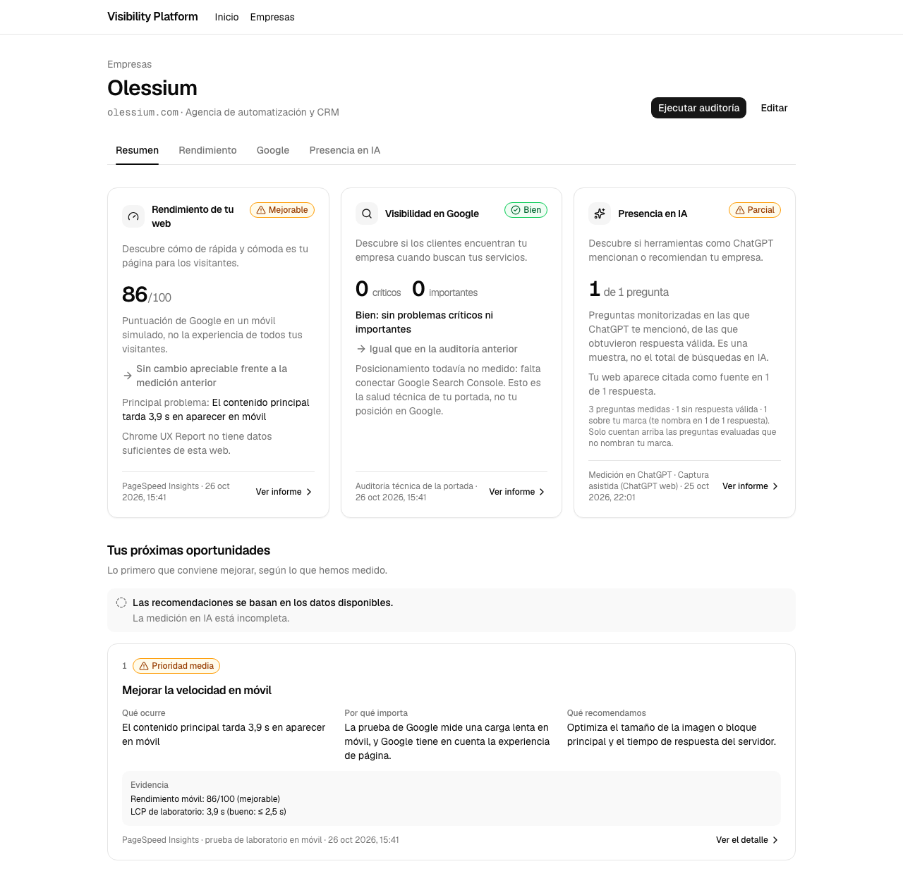

# 17 — Diseño de producto del dashboard (rediseño P0)

**Estado:** implementado, auditado y corregido (T008–T014, D018–D023). La comprobación humana de comprensión (AC-018) sigue **pendiente** (§8). El hallazgo de 404 en producción (§6) quedó resuelto el 2026-10-26 con `src/proxy.ts` (roadmap D-28). Feature [`specs/features/002-dashboard-overview`](../../specs/features/002-dashboard-overview/SPEC.md). Sin commits ni despliegue.

Fuente de verdad del comportamiento: [SPEC](../../specs/features/002-dashboard-overview/SPEC.md). Decisiones D001–D023: [DECISIONS](../../specs/features/002-dashboard-overview/DECISIONS.md).

## 1. Objetivo y criterio de éxito

Que el propietario de una pyme, sin conocimientos de SEO, GEO o AEO, responda al abrir su empresa: cómo funciona su web, si le encuentran en Google, si aparece en respuestas de IA, si está mejorando y qué debería mejorar primero. Todo con datos que ya existían (PageSpeed Insights, Chrome UX Report, auditoría técnica, mediciones en ChatGPT), sin cifras inventadas ni puntuaciones compuestas, y sin integraciones nuevas.

## 2. Arquitectura de información

| Ruta | Contenido |
|---|---|
| `/workspaces/[id]` | **Resumen.** Cabecera (nombre, dominio, sector, ciudad; «Ejecutar auditoría», «Editar»), pestañas, tres tarjetas y «Tus próximas oportunidades». Nada más |
| `/workspaces/[id]/performance` | **Rendimiento.** Móvil y escritorio (no disponible), prueba de laboratorio (LCP, FCP, TBT, CLS), visitantes reales (LCP, INP, CLS solo con datos de campo), problemas de velocidad, histórico |
| `/workspaces/[id]/seo` | **Google.** Posicionamiento (Search Console no disponible, sin enlace), salud técnica, seis áreas, problemas con evidencia, histórico de SEO |
| `/workspaces/[id]/geo` | **Presencia en IA.** Resumen de la medición, visibilidad y menciones (GEO) con «Comparación de menciones» por marca, preguntas y oportunidades de contenido (AEO), histórico de mediciones |
| `/workspaces/[id]/geo/setup` | **Configurar la medición en IA.** Alias, competidores y sugerencias, preguntas, nueva medición (formularios y acciones existentes) |
| `/workspaces/[id]/audits/[auditId]` y `/geo/runs/[runId]` | Auditoría técnica completa y medición concreta (existentes; el run muestra ruta Empresas › empresa › Presencia en IA y el nombre de la empresa en el título) |

Navegación: pestañas Resumen · Rendimiento · Google · Presencia en IA (en móvil, «IA») en todas las páginas de la empresa, con la activa marcada; ruta de navegación Empresas › empresa › sección. Cada tarjeta del resumen lleva a su detalle; cada oportunidad, al hallazgo o apartado que la respalda. La ficha completa sale del resumen (sigue en «Editar») y el histórico técnico pasa a los detalles. La página de inicio sigue siendo el panel del operador (D009).

## 3. Diseño

### Principios

- **Una tarjeta, un enlace.** Toda la tarjeta es un `<a>` sin controles dentro, con título y resumen como nombre y descripción accesibles y foco visible.
- **Color solo con significado.** Neutros por defecto; verde, ámbar, rojo y azul solo para estados y prioridades, siempre con icono y texto (nunca solo color). Sin bordes de color por métrica.
- **Un acento de marca, nunca de estado.** El violeta `--brand` (y la tinta `--primary`) da identidad: logo, pestaña activa, iconos de tarjeta, enlaces «Ver informe», numeración de oportunidades, botón principal y el brillo del fondo. No significa bien ni mal, así que nunca se usa para un estado. Los neutros llevan un tinte frío y las tarjetas son blancas sobre fondo tintado, con sombra `shadow-card`.
- **Sin puntuación compuesta (B06).** Rendimiento muestra la puntuación de Google; Google, conteos de problemas; IA, «k de n preguntas evaluadas».
- **Fuente y fecha en cada cifra.** Cada tarjeta y oportunidad dice de dónde sale y cuándo se midió.
- **Lenguaje de propietario.** Cada métrica técnica lleva una frase de lo que significa y la referencia de «bueno».
- **Solo lo observado (D021).** Los textos describen lo que se preguntó, respondió o midió; las acciones de contenido se plantean como revisión, sin diagnosticar carencias no analizadas.

### Tarjetas del resumen

| Tarjeta | Valor principal | Además |
|---|---|---|
| Rendimiento de tu web | Puntuación móvil /100 y veredicto (Bueno/Mejorable/Malo), fuente PageSpeed Insights | Aclaración «móvil simulado», cambio frente a la medición anterior, principal problema, línea de visitantes reales con su propia fuente: «Chrome UX Report», alcance (esta página / todo el sitio) y periodo, o su ausencia sin causa inventada (D020) |
| Visibilidad en Google | Críticos e importantes de SEO (sin velocidad) | Titular, cambio comparable, «Posicionamiento todavía no medido: falta conectar Google Search Console» |
| Presencia en IA | «k de n preguntas» monitorizadas y evaluadas sin tu marca | Muestra, no total de búsquedas; respuestas que citan tu web; nota con preguntas medidas, sin respuesta válida y de marca; principal oportunidad |

### Estados

Resultado e intento son dimensiones separadas (D011): un intento posterior en curso o fallido no borra ni rejuvenece el último resultado, se añade como aviso.

| Estado | Rendimiento | Google | IA |
|---|---|---|---|
| Sin configurar | «No medida» + falta la clave | — | «Sin configurar» → configuración |
| Sin datos | «No medida» + ejecutar auditoría | «Sin auditoría» | «Sin mediciones · Pendiente de medir» → configuración |
| Analizando | «Analizando» | «Analizando» | «Recogiendo respuestas» (+ enlace al run en el informe) |
| Parcial | «No medida» con motivo (cuota, error, portada ilegible) | «Parcial» o «Mal/Regular (parcial)»; áreas «No comprobado» | «Parcial» con motivo (no recogidas / sin respuesta válida) |
| Error | «Error · Sin resultado» | «Error · Sin resultado» | «Error» (todas las observaciones fallaron) |
| Datos antiguos | Aviso «Datos de hace N días» (> 30 × 24 h) en los tres, compatible con cualquier estado |||
| Intento posterior | Aviso «Actualizando…» o «El último intento no terminó» conservando el resultado fechado |||

Nunca se muestra un cero sin medición; un cero solo aparece con denominador válido («0 de 4»).

### Comparabilidad (D012, D015)

- **Velocidad:** solo con la auditoría completada inmediatamente anterior, misma estrategia y misma versión mayor de Lighthouse; ±9 puntos es ruido, ±10 es cambio.
- **Google:** conteos sin velocidad; misma cobertura (categorías comprobadas y versión de reglas). Si no, «Sin comparación».
- **IA:** solo la medición completada inmediatamente anterior, misma configuración, ambas **completas** y mismas preguntas evaluadas («Antes: k de n»). Completa (D018) = todo recogido, todo con respuesta válida y al menos una pregunta sin marca evaluada; la misma definición decide el estado `ok`/`partial`. Un caso A/B/A no compara la última A con la primera.
- **Gráfica de velocidad (D019):** la línea solo une puntos consecutivos con puntuación y misma estrategia y versión mayor conocidas; se corta con versión distinta, desconocida o auditoría sin medición. El aviso bajo la gráfica se calcula sobre los puntos mostrados.

### Oportunidades

Hasta tres, una por tipo, por prioridad: crítico (alta), velocidad mala (alta) o mejorable (media), importantes de metadatos/sitemap/canonical/indexabilidad (media), preguntas de IA evaluadas sin mención (media, con incertidumbre explícita), datos estructurados ausentes (baja, «no garantizan aparecer en respuestas de IA»). Cada una: qué ocurre, por qué importa, qué recomendamos, prioridad, evidencia, fuente y fecha, y enlace. Cero es una respuesta válida, con tres mensajes: sin datos («Todavía no podemos recomendar mejoras»), datos parciales (lista de lo pendiente) y todo medido sin candidatos («No hemos detectado problemas prioritarios en las mediciones disponibles»).

## 4. Componentes

### Creados

| Componente | Archivo | Uso |
|---|---|---|
| Módulo de resúmenes (puro, sin E/S) | `src/modules/overview/` | `summarizePerformance`, `summarizeSeo`, `seoAreaStatuses`, `seoHistoryPoints`, `summarizeAi`, `buildOpportunities`, `isStale`/`staleInfo` |
| `PageHeader` | `src/components/overview/page-header.tsx` | Ruta, título, contexto, acciones |
| `WorkspaceNav` | `src/components/overview/workspace-nav.tsx` | Pestañas de la empresa |
| `OverviewCard`, `ChangeLine`, `NoticeList` | `src/components/overview/overview-card.tsx` | Tarjeta clicable, línea de cambio, avisos |
| `Opportunities` | `src/components/overview/opportunities.tsx` | 0–3 oportunidades con evidencia |
| `ChartDataTable`, `ProblemsLegend`, `SpeedLegend` | `src/components/audits/evolution-chart.tsx` | Tabla oculta para lectores de pantalla (con versión de la prueba en velocidad) y leyendas, ahora exportadas |
| `speedMethodology`, `sameMethodology`, `speedSegments`, `speedBreaks` | `src/modules/audits/evolution.ts` | Metodología de cada punto y segmentación de la línea (D019), compartidas con la comparación del resumen |
| `isCompleteResult`, `fieldPeriod` | `src/modules/overview/{ai,performance}.ts` | Definición única de resultado IA completo (D018); periodo CrUX en texto breve (D020) |
| Páginas | `src/app/workspaces/[id]/{performance,seo,geo/setup}/page.tsx` | Detalles y configuración |

### Reutilizados

`StatusPill`, `ToneIcon`, `toneClasses`; `ProblemsChart` y `SpeedChart` (exportados sin cambiar el dibujo); `RunAuditButton`; formularios GEO y `CompetitorSuggestions`; `rateMetric`, `auditHeadline`, `isCategoryChecked` (exportada), `SCORE_NOISE`, `toPoint`; `computeGeoMetrics`; lecturas `listAudits`, `getAudit`, `listGeoRuns`, `listPrompts`; todas las acciones de servidor existentes.

### Retirados (código que este cambio dejó sin uso)

`computeEvolution` con sus indicadores y tendencia, y `EvolutionChart` (D017).

### Backend

Solo ensamblaje de lecturas existentes y revalidación (coste real por página en D023 y §6): las acciones de IA revalidan resumen, informe y configuración (y el run en captura y actualización); ejecutar auditoría revalida resumen, `/performance` y `/seo`. Sin esquema, migraciones, proveedores, captura, reglas de auditoría ni PDF.

## 5. Pruebas realizadas

### Comandos (2026-10-26, tras el último cambio de código)

| Comando | Salida | Resultado |
|---|---|---|
| `npm run lint` | 0 | Sin problemas |
| `npm run typecheck` | 0 | Tipos de rutas generados, `tsc` limpio |
| `npm run test:unit` | 0 | 34 archivos, 379 pruebas (50 del módulo `overview`, 7 de `evolution`) |
| `npm run test:integration` | 0 | 8 archivos, 74 pruebas contra Neon `test` |
| `npm run build` | 0 | Compila; rutas nuevas `/performance`, `/seo`, `/geo/setup` |

Ejecución final tras las correcciones de la auditoría (2026-10-26); la tabla sustituye a la ejecución anterior de T007 (366 pruebas unitarias), que se hizo antes de T008–T012.

Las pruebas del módulo cubren, entre otros: A/B/A, «2 de 4» con 6 sin respuesta y marca aparte, citas por respuestas, «0 de 4» frente a denominador cero, solo preguntas de marca, todas fallidas, repeticiones fallidas, resultado conservado ante intento en curso/fallido, preguntas archivadas, cambio solo de velocidad, cobertura distinta/desconocida/no cargada, hallazgos no cargados (nunca «Bien»), Lighthouse distinto/desconocido, ±9/±10, 30 días exactos y 30 días + 1 ms, y los tres mensajes de oportunidades. Dos mutaciones de control (umbral de ruido y salto de configuración) hicieron fallar sus pruebas.

Componentes sin pruebas unitarias por falta de entorno DOM (D016): verificados en navegador.

### Verificación en navegador

Entorno: servidor de desarrollo ya en marcha (`localhost:3000`, rama Neon `dev`) y panel de navegador de la sesión. Fecha: 2026-10-26.

### T002 · componentes (verificados sobre el resumen de T003)

- Cada tarjeta es un único `<a>` con `aria-labelledby` (título) y `aria-describedby` (resumen); 0 elementos interactivos anidados en las tres.
- Teclado: Tab desde la última pestaña lleva a la primera tarjeta con `:focus-visible`; Enter navega a `/performance`.
- Hallazgo y corrección: el anillo de foco usaba `--ring` (gris claro, contraste ≈ 2,6:1 sobre blanco, por debajo de 3:1). Los componentes nuevos usan `ring-foreground/60`; el anillo es visible en captura. El token global no se ha cambiado.
- Pestañas con `aria-current="page"` en la activa. A 375 px «Presencia en IA» no cabía: en móvil la pestaña se muestra como «IA»; ancho de la navegación 375/375.
- La tarjeta de Google contiene solo titular, conteos, cambio comparable, fecha y la explicación de posicionamiento no medido; las seis áreas no están en el resumen (AC-014).

### T003 · resumen

| Empresa (dev) | Auditorías | Mediciones IA | Observaciones | Estados cubiertos |
|---|---|---|---|---|
| Olessium | 4 | 1 | 3 | Rendimiento medido (86/100, «Mejorable», sin cambio apreciable), Google «Bien» con comparación, IA parcial (1 de 1 evaluada, 1 sin respuesta válida, 1 de marca aparte), oportunidad de velocidad media con evidencia |
| Buchhandlung Müller | 0 | 0 | 0 | Vacío: «No medida», «Sin auditoría», IA «Sin configurar» con enlace a configuración, «Todavía no podemos recomendar mejoras» |
| Clínica Dental García Valladolid | 2 | 0 | 0 | Parcial: rendimiento no medido por portada ilegible, Google «Mal (parcial)» con 2 críticos y sin comparación por cobertura distinta, oportunidad alta de HTTPS, aviso de límites |

- Sin ficha, lista de auditorías ni gráficas en el resumen. Sin desbordamiento horizontal a 1280 ni a 375 px.
- Id inexistente: HTTP 404.
- Tiempo de respuesta local del resumen de Olessium (3 peticiones con `curl`, servidor de desarrollo): 0,34–0,36 s. Volumen pequeño; no es una prueba de escala.
- Correcciones hechas durante la verificación: concordancia «1 de 1 pregunta»; tarjeta de IA condensada con una nota al pie (preguntas medidas, respuestas recogidas, sin respuesta válida, preguntas de marca); titular de IA sin repetir la etiqueta de estado; rendimiento sin medir etiquetado «No medida» en lugar de «Parcial»; SEO parcial con críticos etiquetado «Mal (parcial)» en rojo.
- Los estados de datos antiguos, intento fallido, error y analizando se verificaron en T007 con datos de prueba (ver más abajo).
- Todas las rutas del resumen existen desde T006.

### T004 · detalle de rendimiento

| Empresa (dev) | Resultado |
|---|---|
| Olessium | 86/100 «Mejorable», sin cambio apreciable (95 → 86, dentro del ruido), Lighthouse 13.5.0; LCP 3,9 s «Mejorable», FCP, TBT y CLS «Bueno», cada una con explicación y referencia; visitantes reales «sin suficientes visitas»; INP ausente; un problema de velocidad con explicación, recomendación y evidencia; histórico con 2 medidas y 2 auditorías sin medición mostradas como «—» |
| Clínica García | «No medida» con motivo (portada ilegible); sin métricas, sin problemas detectables y sin histórico, cada uno con su frase |
| Buchhandlung Müller | Estado vacío «Todavía no hay mediciones de velocidad» con el botón de auditoría en la cabecera |

- Escritorio aparece como «No disponible» con su motivo (D004).
- Ids inexistentes y mal formados: HTTP 404. Sin desbordamiento a 375 px. Respuesta local: 0,46–0,47 s.
- Añadido durante la verificación: la gráfica (sin cambios de dibujo) une todas las puntuaciones; si mezclan versiones mayores de Lighthouse, una nota lo advierte bajo la gráfica.
- No se usa `MetricTile` (borde de color por métrica): lista sobria con explicación al lado de cada valor.

### T005 · detalle de Google y limpieza

| Empresa (dev) | Resultado |
|---|---|
| Olessium | «Bien: sin problemas críticos ni importantes», 0/0/1, «Igual que en la auditoría anterior»; seis áreas (Estructura «Mejorable · 1», resto «Bien»); un problema con recomendación y evidencia; histórico de 4 auditorías con 1 mejora cada una (los hallazgos de velocidad no cuentan) |
| Clínica García | Parcial: «2 problemas críticos», detalle de cobertura parcial, «Sin comparación: la auditoría anterior comprobó cosas distintas»; Metadatos, Estructura, Canonicals y Datos estructurados «No comprobado»; la oportunidad del resumen enlaza al hallazgo de HTTPS en esta página |
| Buchhandlung Müller | Search Console no disponible + «Todavía no hay auditorías» con la acción en la cabecera |

- Search Console: bloque «No disponible todavía» sin enlaces ni botones; no se muestra ninguna cifra de tráfico.
- Ids inexistentes y mal formados: HTTP 404. Sin desbordamiento a 375 px. Respuesta local: 0,34–0,68 s con 4 auditorías.
- Corregido durante la verificación: claves duplicadas en `ProblemsChart` con máximo 1 (D017).
- Limpieza: `computeEvolution` y `EvolutionChart` retirados por quedar sin uso tras T003; su tabla para lectores de pantalla se conserva como `ChartDataTable` en ambos detalles (D017).

### T006 · informe y configuración de IA

| Caso | Resultado |
|---|---|
| Olessium (medición real, captura asistida) | «1 de 1 pregunta evaluada», «Parcial» con motivo «1 pregunta no obtuvo respuesta válida», citas 1 de 1 respuesta, 3 de 3 recogidas, marca aparte; tabla por pregunta con competidor confirmado; AEO con «Te menciona» y «Sin respuesta válida» separadas y aviso de límites |
| Clínica García | «Todavía no hay preguntas» con enlace a configurar |
| Buchhandlung Müller (flujo de escritura) | Ver abajo |

Flujo de escritura en `dev`, empresa de prueba Buchhandlung Müller (D-09), textos marcados «[PRUEBA]», proveedor manual sin coste, todo con navegación interna (una marca en `window` sobrevivió a cada paso: sin recargas completas):

1. Añadir la pregunta «[PRUEBA] ¿Qué librería me recomiendas en Berlín?» en `/geo/setup` → el resumen pasa de «Sin configurar» a «Sin mediciones · Pendiente de medir».
2. Iniciar medición → redirige al run; vuelta «← Presencia en IA».
3. `/geo` muestra «Recogiendo respuestas de la primera medición» y el resumen «Recogiendo respuestas» (estado analizando verificado en navegador).
4. Registrar una respuesta sintética marcada «[PRUEBA] … no generada por ChatGPT» con la web propia como fuente → `/geo`: 1 de 1 pregunta, 1 de 1 respuesta citando la web, pregunta en «Te menciona».
5. Archivar la pregunta → el resumen conserva «1 de 1 pregunta» fechado y avisa «No hay preguntas activas».

Queda en `dev` una medición de prueba de Müller (la aplicación no permite borrar mediciones) con su respuesta sintética, identificable por «[PRUEBA]».

- Ids inexistentes y mal formados en `/geo` y `/geo/setup`: HTTP 404. Un run de otra empresa: HTTP 404.
- 375 px: sin desbordamiento de página en `/geo` ni `/geo/setup`; la tabla por pregunta se desplaza dentro de su contenedor (600 px de contenido en 341 px).
- Revalidación: todas las acciones de IA revalidan resumen, informe y configuración; captura manual y actualización, además, el run. Ejecutar auditoría revalida resumen, `/performance` y `/seo`.
- Corregido durante la verificación: el motivo de «Parcial» decía «algunas respuestas no se pudieron recoger» cuando todo se había recogido y una respuesta estaba vacía; ahora distingue ambos casos (prueba añadida).
- Corregido antes de verificar: un reemplazo global hizo que el ayudante de revalidación se llamara a sí mismo (recursión infinita); detectado al revisar el diff, no por typecheck.

### T007 · estados con datos de prueba

Los estados de datos antiguos, intento fallido, error y analizando no existen en `dev`. Se generaron tres empresas «[FIXTURE]» en la base `visibility_test` con un script externo al repositorio que pasa las dos capas de la guardia de pruebas y usa los servicios reales (`createWorkspace`, `evaluateAudit`, `addPrompt`, `createGeoRun`, `recordManualObservation`), y se sirvieron con `next start` en el puerto 3100 apuntando a esa base. Al terminar, el script las borró (3 eliminadas) y el servidor se detuvo.

| Empresa de prueba | Resultado |
|---|---|
| Datos antiguos | Rendimiento 48/100 «Malo», «-14 puntos» (62 → 48, misma versión), «El último intento de auditoría no terminó», «Datos de hace 45 días»; Google 0/3 con los mismos avisos y conteos sin velocidad (0/3/3 frente a 6 hallazgos totales); IA «1 de 2 preguntas» con «Recogiendo respuestas de una medición nueva» y «Datos de hace 40 días»; oportunidades alta de velocidad y medias de canonical y metadatos |
| Error | Tres tarjetas «Error · Sin resultado» con su motivo; informe de IA «La medición no pudo recoger ninguna respuesta» con enlace a la medición; «Todavía no podemos recomendar mejoras» |
| Analizando | Rendimiento y Google «Analizando…»; IA «Sin configurar» |

Corregido durante esta verificación: con intentos sin resultado, la fuente decía «sin auditar» o «sin mediciones»; ahora dice «sin resultado».

### Capturas

Generadas con `playwright-core` y el Chromium del proyecto, página completa, 1280 y 375 px; el indicador de desarrollo de Next se oculta. 26 capturas, todas con HTTP 200, 0 px de desbordamiento horizontal y tablas con cabeceras. Carpeta: [`assets/17-dashboard/`](assets/17-dashboard/).

| Datos reales (`dev`) | Datos de prueba (`visibility_test`) | Demostración (`dev`) |
|---|---|---|
| [Resumen Olessium 1280](assets/17-dashboard/overview-olessium-1280.png) · [375](assets/17-dashboard/overview-olessium-375.png) | [Datos antiguos 1280](assets/17-dashboard/fixture-overview-datos-antiguos-1280.png) · [375](assets/17-dashboard/fixture-overview-datos-antiguos-375.png) | [Resumen Müller](assets/17-dashboard/demo-overview-muller-1280.png) |
| [Resumen García parcial](assets/17-dashboard/overview-garcia-parcial-1280.png) | [Error](assets/17-dashboard/fixture-overview-error-1280.png) · [Analizando](assets/17-dashboard/fixture-overview-analizando-1280.png) | [Informe Müller](assets/17-dashboard/demo-geo-muller-1280.png) |
| [Rendimiento Olessium 1280](assets/17-dashboard/performance-olessium-1280.png) · [375](assets/17-dashboard/performance-olessium-375.png) | [Versiones de Lighthouse 1280](assets/17-dashboard/fixture-performance-versiones-1280.png) · [375](assets/17-dashboard/fixture-performance-versiones-375.png) | [Run Müller](assets/17-dashboard/demo-run-muller-1280.png) |
| [Google García 1280](assets/17-dashboard/seo-garcia-parcial-1280.png) · [375](assets/17-dashboard/seo-garcia-parcial-375.png) | [CrUX por URL](assets/17-dashboard/fixture-overview-crux-url-1280.png) · [CrUX por origen](assets/17-dashboard/fixture-overview-crux-origen-1280.png) | |
| [IA Olessium 1280](assets/17-dashboard/geo-olessium-1280.png) · [375](assets/17-dashboard/geo-olessium-375.png) | [IA parcial resumen](assets/17-dashboard/fixture-overview-ia-parcial-1280.png) · [informe 1280](assets/17-dashboard/fixture-geo-ia-parcial-1280.png) · [375](assets/17-dashboard/fixture-geo-ia-parcial-375.png) | |
| [Configuración García](assets/17-dashboard/geo-setup-garcia-1280.png) | [Google datos antiguos 375](assets/17-dashboard/fixture-seo-datos-antiguos-375.png) · [Configuración error 375](assets/17-dashboard/fixture-geo-setup-error-375.png) | |

Las capturas de datos de prueba se regeneraron en esta ronda con las empresas de prueba nuevas; las de la ronda anterior se sustituyeron.

### Correcciones tras la auditoría (T008–T014)

| Hallazgo | Archivos | Evidencia |
|---|---|---|
| 1. Comparación entre mediciones IA parciales | `src/modules/overview/ai.ts`, `tests/unit/overview/ai.test.ts` | Reproducido con una prueba: dos runs completados con la misma clave y `p2` sin respuesta en ambos daban `partial` y `better`. Esa prueba y la de «repetición sin respuesta válida» fallaban antes y pasan ahora. Añadidas también: solo la última parcial, solo la anterior parcial, dos completas con pregunta de marca (sí se comparan). Siguen las de captura incompleta, denominador cero, conjuntos distintos y A/B/A. En navegador, una empresa de prueba con dos mediciones parciales muestra «Parcial» y «Sin comparación: alguna de las dos mediciones no está completa» |
| 2. Histórico de rendimiento con continuidad no comparable | `src/modules/audits/evolution.ts`, `src/components/audits/evolution-chart.tsx`, `src/app/workspaces/[id]/performance/page.tsx`, `src/modules/overview/performance.ts`, `tests/unit/audits/evolution.test.ts` | 4 pruebas de metodología, segmentos y motivos (fallaban antes de implementar). En navegador, seis mediciones 13.1/13.5/12.8/desconocida/13.5/13.5: dos trazos (60–72 y 66–70), 50 y 55 aislados, aviso «se interrumpe por versiones distintas… y mediciones cuya versión… no consta», tabla accesible con columna «Prueba» |
| 3. Atribución de CrUX en la tarjeta | `src/modules/overview/performance.ts`, `src/app/workspaces/[id]/page.tsx`, `src/app/workspaces/[id]/performance/page.tsx` | 4 pruebas: URL, origen, sin alcance ni periodo, sin datos. En navegador: «Visitantes reales de esta página…» / «…de todo el sitio (la portada no tiene datos propios)…» con «Fuente de este dato: Chrome UX Report · del 27 sept 2026 al 24 oct 2026», separada de «PageSpeed Insights» en el pie |
| 4. Inferencias no respaldadas | `src/app/workspaces/[id]/geo/page.tsx`, `src/modules/overview/opportunities.ts`, `src/app/workspaces/[id]/performance/page.tsx`, `src/app/workspaces/[id]/page.tsx`, `src/modules/overview/ai.ts` | Búsqueda en `src` sin coincidencias de los textos señalados ni de «preguntas de clientes», «pierde visitantes», «puede marcharse», «Cada vez más». «Comparación de menciones» en el informe; la spec ya no promete «cuota de voz» |
| 5. Medición sintética en `dev` | `src/app/workspaces/[id]/geo/page.tsx`, `src/app/workspaces/[id]/geo/runs/[runId]/page.tsx`; dato: nombre de la empresa de prueba | Antes: resumen sin ninguna marca de demostración, run con la palabra «sintética» solo dentro de la respuesta plegada. Ahora la empresa se llama «Buchhandlung Müller · DEMOSTRACIÓN, datos sintéticos» (cambiado desde «Editar»), visible en el título del resumen, en la descripción del informe sobre sus métricas y en la ruta y el título del run. Sin filtros por texto en `src`, sin filas borradas |
| 6. Documentación | SPEC, PLAN, TASKS, DECISIONS, esta doc | AC-020–AC-025, T008–T014, D018–D023; D012 y D017 marcadas como parcialmente sustituidas; TASKS y PLAN alineados con el estado real y con D017 |

Datos de prueba de esta verificación: seis empresas «[FIXTURE]» en `visibility_test` (datos antiguos, error, analizando, versiones de Lighthouse, CrUX por origen, IA parcial), creadas con los servicios reales tras la guardia de dos capas, servidas con `next start` en el puerto 3100 y borradas al terminar (6 eliminadas).

Comprobaciones de esta ronda en navegador y con `playwright-core` (26 páginas): HTTP 200 y 0 px de desbordamiento a 1280 y 375 px en resumen, `/performance`, `/seo`, `/geo` y `/geo/setup`; todas las tablas con celdas de cabecera; estados vacío (Müller, rendimiento), parcial (García, IA parcial), error, analizando y datos antiguos; teclado en pestañas con anillo visible y Enter; archivar preguntas en el build de producción actualiza el resumen sin recarga y conserva el resultado; 404 en el servidor de desarrollo para las cinco rutas con id inexistente o mal formado.

## 6. Revisiones

Hechas por el implementador sobre el diff completo (PLAN: un único agente, sin delegación). No sustituyen a una revisión independiente.

| Revisión | Hallazgos | Resolución |
|---|---|---|
| Frontend y QA | Foco con contraste ≈ 2,6:1; pestaña cortada a 375 px; tarjeta de IA sobrecargada; parcial con críticos en gris; fuente «sin mediciones» tras un intento fallido; motivo de «Parcial» incorrecto | Corregidos (§5) |
| Lógica de resúmenes | Si los hallazgos de la auditoría resultado no se cargaban, SEO habría mostrado «Bien» | Ahora estado de error; prueba añadida |
| Rendimiento y acceso a datos | El resumen y `/geo` cargan todas las mediciones con todas sus observaciones (incluido el texto de las respuestas) mediante `listGeoRuns`; `listAudits` trae los `facts` de cada auditoría; `/seo` hace hasta 14 llamadas a `getAudit` (≤ 30 consultas SQL); resumen ≤ 9, `/performance` ≤ 4, `/geo` ≤ 4 (D023) | Sin cambio en P0 (fuera de alcance); acotado y documentado (§7). Volumen local: 4 auditorías, 1 medición, 3 observaciones; 0,3–0,7 s por página en el servidor de desarrollo |
| Seguridad | Las páginas nuevas resuelven la empresa por id y consultan siempre con su id (`getAudit` y `getGeoRun` filtran por empresa; un run ajeno da 404). Sin `dangerouslySetInnerHTML` en `src`; evidencias y preguntas se pintan como texto. Sin entradas nuevas ni acciones nuevas | Sin hallazgos. Perímetro sin autenticación sin cambios (D-03) |
| Auditoría del 2026-10-26 (externa) | Seis hallazgos: comparación IA parcial, continuidad de la gráfica de velocidad, atribución CrUX, inferencias en textos, dato sintético sin identificar, documentación desalineada | Resueltos (§5, T008–T014) |
| 404 en build de producción (encontrado en T014) | Con `next start`, `/workspaces/<id inexistente>` y todas sus subrutas, incluidas `/edit`, auditoría y run (no modificadas por este rediseño), devuelven HTTP 200 con el contenido «Empresa no encontrada», marcador 404 y `noindex`. El servidor de desarrollo devuelve 404 real | **Resuelto** (2026-10-26, roadmap D-28, D024): causa, el prerender con estado pospuesto fija 200 antes de `notFound()`; `instant = false` no lo evita. `src/proxy.ts` comprueba la existencia antes del render y reescribe a `/_not-found` (404, `src/app/not-found.tsx`). Verificado con `next start`: 404 en las ocho rutas con ids inexistentes o mal formados y en HEAD; 200 en los existentes; acciones de servidor sin cambios |
| Conformidad con AC-019 | `package.json`, migraciones, `rules.ts`, informes, proveedores y captura sin tocar; `lead-platform` no está en este árbol y no se ha modificado; HEAD sigue en `ed5f782` | Conforme |

## 7. Limitaciones conocidas

- **Posicionamiento real en Google:** no se mide; el bloque de Search Console es un estado vacío explicado, sin enlace ni cifras.
- **Escritorio:** no se mide (la integración usa solo el perfil móvil).
- **AEO:** se basa en menciones observadas en ChatGPT, no en el contenido de la web; la falta de mención no demuestra falta de contenido.
- **Muestras pequeñas de IA:** pocas preguntas y una repetición; «k de n» no es una cuota de búsquedas.
- **Demostración identificada por empresa, no por medición:** la tarjeta de IA no lleva la etiqueta dentro; aparece en el título justo encima. Marcar mediciones individuales como sintéticas requiere un campo en `geo_runs` (P1, migración). El nombre congelado en la configuración de esa medición sigue siendo el anterior.
- **404 en visitas directas:** muestran la página global «Página no encontrada»; la navegación interna sigue mostrando «Empresa no encontrada» (con estado 200, no visible). Cada petición de documento a `/workspaces/<id>/…` hace una o dos consultas por clave primaria en el proxy.
- **Gráfica de velocidad:** sin línea entre mediciones no comparables; con muchas versiones distintas puede verse como puntos sueltos.
- **Etiqueta «Medido» en IA:** usa el icono neutro de círculo discontinuo, que puede leerse como «pendiente». No hay umbral definido para colorear la presencia en IA; se deja neutra a propósito.
- **Sin pantalla de carga propia:** las rutas son bloqueantes para devolver 404 reales; durante la navegación se mantiene la página anterior hasta tener la nueva.
- **Coste de lecturas (D023):** `/seo` hasta 30 consultas SQL; el histórico GEO completo (todas las mediciones y observaciones, con el texto de las respuestas) se carga en el resumen y en `/geo` sin tope.
- **Histórico SEO:** limitado a las 12 auditorías más recientes en el detalle (D017).
- **Datos de prueba en `dev`:** una medición «[PRUEBA]» de Buchhandlung Müller, conservada e identificada como demostración (D022).
- **Anillo de foco global:** el token `--ring` del resto de la aplicación sigue por debajo de 3:1; solo los componentes nuevos usan un anillo más oscuro.

## 8. Comprobación humana pendiente (AC-018)

No realizada: requiere una persona ajena a la implementación o el propietario del proyecto. La feature no se cierra sin ella.

Protocolo propuesto:
1. Abrir el resumen de Olessium (y, si es posible, el de Clínica García) a 1280 px, sin explicar nada.
2. Tras diez segundos, preguntar: ¿cómo funciona la web?, ¿te encuentran en Google?, ¿apareces en respuestas de IA?, ¿está mejorando?, ¿qué harías primero?
3. Registrar aquí participante, fecha, respuestas, qué bloque o estado no se entendió (incluido «no medido») y qué cambio de texto o jerarquía sugiere.

## 9. Siguientes pasos

- **Antes de cerrar:** comprobación humana (§8); revisiones independientes (frontend/QA, lógica y acceso a datos) y `/spec-review`.
- **P1 (fuera de este rediseño):** integración real con Google Search Console (clics, impresiones, CTR, posición media con sus límites, consultas, páginas, marca/sin marca); mediciones GEO verificadas con DataForSEO; comparativas avanzadas; análisis de contenido para AEO.
- **Prueba intermitente (roadmap D-24):** la prueba de concurrencia de auditorías falló en 2 de 3 ejecuciones el 2026-10-26 sin cambios en su código; conviene hacer el solapamiento determinista.
- **P1 de datos:** campo de origen de la medición (real, demostración) en `geo_runs` para identificar mediciones sintéticas una a una.
- **Deuda técnica observada:** paginar o resumir en base de datos las mediciones y observaciones que leen el resumen y `/geo`; subir el contraste del token `--ring` global; definir si la presencia en IA merece un umbral de color.
- **P2:** informes PDF comerciales, suscripciones, agencias y marca blanca.
